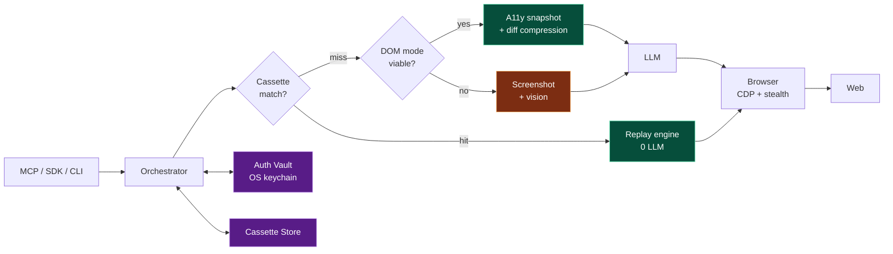

<div align="center">

# genATP

**The unified web-access layer for AI agents.**
*Generative Agent Test Protocol — one install, any agent, any LLM, 10× fewer tokens.*

[](LICENSE)
[](#roadmap)
[](#contributing)

[Quickstart](#quickstart) · [Why genATP](#why-genatp) · [Docs](./docs) · [Roadmap](#roadmap)

</div>

---

## What it is

Every AI agent that touches the web today is duct-taped together from six vendors and burns ~2 million tokens to do what a human does in 30 seconds. genATP replaces that whole stack with **one install** and adds two things nothing else has:

- 🎞️ **Action Cassettes** — record-once, replay-forever web workflows. Replays use **zero LLM calls** and self-heal when sites change.
- 📜 **ATP Spec** — a declarative YAML/JSON format that doubles as test, automation, and production agent tool.

Plus the modern essentials: token-optimized snapshots, encrypted auth vault, automatic DOM ↔ vision switching, stealth defaults, MCP server, Python and TypeScript SDKs — all in one binary.

---

## Why genATP

|  | browser-use | Stagehand | Playwright MCP | Skyvern | **genATP** |
|---|:-:|:-:|:-:|:-:|:-:|
| Python SDK | ✅ | ❌ | ❌ | ✅ | ✅ |
| TypeScript SDK | ❌ | ✅ | ✅ | ❌ | ✅ |
| MCP server built-in | ❌ | ❌ | ✅ | ❌ | ✅ |
| Token-optimized snapshots | partial | partial | ❌ | n/a | ✅ |
| DOM ↔ vision auto-switch | ❌ | ❌ | ❌ | ❌ | ✅ |
| Encrypted auth vault | ❌ | ❌ | ❌ | ❌ | ✅ |
| Stealth (OSS) | ❌ | ❌ | ❌ | partial | ✅ |
| Self-hosted | ✅ | partial | ✅ | ✅ | ✅ |
| **Deterministic replay (Cassettes)** | ❌ | ❌ | ❌ | ❌ | **✅** |
| **Declarative spec format** | ❌ | ❌ | ❌ | ❌ | **✅** |
| **Community registry** | ❌ | ❌ | ❌ | ❌ | **✅** |

### Real numbers, not slogans

| Task | Playwright MCP | browser-use | **genATP** |
|---|---:|---:|---:|
| 20-step WebVoyager task — first run | 2,280,000 tok | 1,400,000 tok | **34,000 tok** |
| 20-step task — cassette replay | n/a | n/a | **0 tok** ✨ |
| Login persistence across runs | ❌ | ❌ | ✅ encrypted vault |
| Self-heal on site change | ❌ | ❌ | ✅ automatic |

(Detailed methodology in [`docs/BENCHMARK.md`](./docs/BENCHMARK.md).)

---

## Quickstart (Python SDK)

```bash
pip install genatp
```

```python
from genatp import Agent

agent = Agent(model="claude-3-5-sonnet-latest")
result = agent.run("Find the cheapest direct flight from SFO to JFK next Friday.")
print(result.summary)
```

Configure a provider via env vars ([`docs/CONFIGURATION.md`](./docs/CONFIGURATION.md)) or pass
`Agent(provider="ollama")`. For a no-API-key smoke test:

```bash
GENATP_LLM_PROVIDER=mock python examples/quickstart.py
```

Async API: `await agent.arun(...)`. LangChain: `from genatp.langchain import as_langchain_tools`.
Full Python docs: [`bindings/python/README.md`](./bindings/python/README.md) and
[`docs/python/`](./docs/python/).

---

## Quickstart (MCP server)

The MCP server lets any MCP-compatible LLM client drive a browser without
writing Python.

### 1. Build

```bash
git clone https://github.com/genatp/genatp && cd genatp
cargo build --release -p genatp-cli
cargo install --path crates/genatp-cli
genatp version
# genatp 1.0.0
```

### 2. Wire it into Claude Desktop

Add to `~/Library/Application Support/Claude/claude_desktop_config.json`
(macOS / Linux) or `%APPDATA%\Claude\claude_desktop_config.json`
(Windows):

```json
{
  "mcpServers": {
    "genatp": {
      "command": "genatp",
      "args": ["serve", "--stdio"]
    }
  }
}
```

Restart Claude Desktop. The MCP indicator shows `genatp` connected.

### 3. Ask it to browse

> *"Open github.com/genatp/genatp and tell me what's in the README."*

Claude calls genATP's `navigate` → `snapshot` → `extract` tools and
returns the answer. Full tool reference: [docs/MCP.md](./docs/MCP.md).

Cursor and the MCP Inspector are wired the same way — see the docs.

### 4. Auth Vault — log in once, ever

```bash
# After the agent finishes an interactive login flow:
#   tools/call save_auth { "domain": "github.com" }
#
# Inspect / manage from the CLI:
genatp vault list
genatp vault revoke github.com
```

Cookies + `localStorage` are sealed under AES-256-GCM with a master
key kept in your OS keychain. Full design and threat model:
[docs/VAULT.md](./docs/VAULT.md).

---

## The killer features, in 30 seconds each

### 🎞️ Action Cassettes — replay without LLMs

```bash
atp record "scrape competitor pricing from acme.com"
# ↳ agent does it once, cassette saved

atp run competitor-pricing
# ↳ replays deterministically, 0 LLM tokens, ~80ms/step

# Tomorrow, acme.com redesigns. Cassette auto-heals:
atp run competitor-pricing
# ↳ ⚠ drift detected on step 4 — patched via LLM, cassette bumped to v1.1
```

### 🔐 Encrypted Auth Vault — log in once, ever

```python
# First run: agent logs in (may prompt for MFA once)
agent.run("Open my latest PR on github.com")

# Every run after: no login, no MFA, no prompts
# Cookies + localStorage encrypted with OS keychain key
agent.run("Find issues assigned to me on github.com")
```

### 📜 ATP Spec — one file, three uses

```yaml
# checkout.atp.yml
version: 1
name: "Stripe checkout — annual plan"
auth: stripe.com
budget: { tokens: 8000, seconds: 30 }
steps:
  - navigate: https://app.stripe.com/billing
  - click: "Upgrade plan"
  - select: { label: "Annual" }
  - fill:   { label: "Card number", from: secret://stripe.card }
  - assert: "Subscription active"
on_change: { strategy: heal, notify: slack://alerts }
```

```bash
atp test checkout.atp.yml      # run in CI
atp run  checkout.atp.yml      # run as automation
agent.use("checkout.atp.yml")  # use inside another agent
```

### 🪙 Token-optimized snapshots

genATP's perception pipeline strips, compresses, and diffs the accessibility tree before it ever reaches the LLM:

```
Raw a11y tree  →  Stripped  →  Ref-compressed  →  Diff
   50,000 tok      12,000 tok     6,000 tok        400-800 tok per step
```

On a 20-step task, that compounds to **a 60–120× reduction vs raw HTML** and ~10× vs Playwright MCP.

### 🧠 DOM ↔ Vision auto-switch

The engine tries DOM mode first (~600 tokens). If the page is a canvas, a shadow-DOM jungle, or the tree is sparse, it falls back to screenshot + vision (~12,000 tokens) **automatically**. Your agent never knows the difference.

### 🥷 Stealth defaults

Modern bot-detection looks at hundreds of signals (mouse cadence, GPU fingerprint, TLS stack, typing entropy). genATP ships with a baseline stealth profile good enough for ~80% of common defenses. Pluggable for the rest.

---

## Use it from any agent

### Claude Desktop / Cursor / any MCP client

```json
// In your MCP client config
{
  "mcpServers": {
    "genatp": {
      "command": "genatp",
      "args": ["serve", "--stdio"]
    }
  }
}
```

Restart your client. genATP exposes all 12 browser tools:

| Tool | Purpose |
|------|---------|
| `navigate` | Navigate to a URL |
| `snapshot` | Capture compressed accessibility tree |
| `click`, `fill` | Interact with elements by `@eN` ref |
| `extract` | Read visible page text |
| `scroll` | Scroll viewport |
| `screenshot` | Capture PNG screenshot (base64) |
| `get_url`, `go_back` | Navigation helpers |
| `save_auth`, `load_auth`, `list_auth` | Auth Vault management |

From **v1.0.0** you also get the Cassette Registry (`genatp registry search`/`install`/`publish`)
and the Time-travel Debugger (`genatp replay <run-id>`). See [`docs/MCP.md`](./docs/MCP.md) for details.

### LangChain / LlamaIndex / your custom agent

```python
from genatp.tools import as_langchain_tools

tools = as_langchain_tools()  # 10 production-ready tools
```

### Plain HTTP

```bash
genatp serve --port 3000
curl -X POST http://localhost:3000/run -d '{"task": "..."}'
```

---

## Architecture (one picture)



Full system, container, component, and deployment diagrams in [`docs/ARCHITECTURE.md`](./docs/ARCHITECTURE.md).

---

## Documentation

| Doc | What's in it |
|---|---|
| [`docs/PRD.md`](./docs/PRD.md) | Product vision, problem, personas, features, success metrics, roadmap |
| [`docs/ARCHITECTURE.md`](./docs/ARCHITECTURE.md) | System / container / component diagrams, data flow, security model |
| [`docs/DEVELOPMENT_PLAN.md`](./docs/DEVELOPMENT_PLAN.md) | 18-phase build plan, tech stack, testing gates, release cadence |
| [`docs/CHANGELOG.md`](./docs/CHANGELOG.md) | Release history across all versions |
| [`docs/MIGRATION.md`](./docs/MIGRATION.md) | v0.x → v1.0 migration guide |
| [`docs/BENCHMARK.md`](./docs/BENCHMARK.md) | WebVoyager methodology, performance budgets, regression detection |
| [`docs/USER_FLOWS.md`](./docs/USER_FLOWS.md) | End-to-end journeys for each persona, with sequence diagrams |
| [`docs/CONFIGURATION.md`](./docs/CONFIGURATION.md) | Provider selection (Ollama / Anthropic / OpenAI / NVIDIA NIM), env vars, `.env` |
| [`docs/MCP.md`](./docs/MCP.md) | MCP server setup for Claude Desktop, Cursor, MCP Inspector |
| [`docs/TESTING.md`](./docs/TESTING.md) | Comprehensive testing guide across all phases |
| [`docs/python/`](./docs/python/) | Python SDK reference (`pip install genatp`) |
| [`bindings/python/README.md`](./bindings/python/README.md) | Python SDK install, async, LangChain, providers |

---

## Roadmap

Full phase plan with testing gates: [`docs/DEVELOPMENT_PLAN.md`](./docs/DEVELOPMENT_PLAN.md).

| Tag | Week | Headline |
|---|---|---|
| **v0.1.0** | 8 | MCP server + token-optimized snapshots + LLM orchestrator. **First public release.** |
| v0.2.0 | 10 | Python SDK (`pip install genatp`) |
| v0.3.0 | 12 | Encrypted Auth Vault |
| **v0.5.0** | 16 | Action Cassettes (record + replay + self-heal) |
| v0.5.1 | 17 | ATP Spec parser + runner |
| v0.6.0 | 19 | TypeScript SDK (`npm install genatp`) |
| v0.7.0 | 21 | Stealth engine |
| v0.7.1 | 22 | DOM ↔ Vision auto-switch |
| v0.8.0 | 26 | Cassette Registry + time-travel debugger |
| **v0.9.0-pre** | — | **v1.0.0 pre-release** |
| **v1.0.0** 🎉 | 40 | **GA** — full WebVoyager benchmark (≥ 85% / ≤ 35k tokens) |
| v1.x | post-GA | Public marketplace, A2A, WebMCP bridge, patched Chromium default |

---

## Pricing

| Tier | Who | Price |
|---|---|---|
| **Personal** | Individuals, non-commercial use | Free, source-available, fully self-hosted — see [LICENSE](./LICENSE) |
| **Commercial** | Companies, paid products, any revenue-generating use | Paid license — `licensing@genatp.dev` |
| **Cloud Pro** | Indie devs, startups | $49/mo flat or $0.005/session (includes commercial use) |
| **Enterprise** | F500, regulated industries | On-prem, audit logs, SOC 2, SSO, SLA — talk to us |

The Personal tier is the full product, not crippled. Any commercial use — including using genATP inside a for-profit company, in a paid service, or as part of a revenue-generating product — requires a Commercial, Cloud, or Enterprise license.

---

## Contributing

This is a serious project. We want serious contributors.

1. **Read the PRD first.** Most "feature idea" discussions are already answered in [`docs/PRD.md`](./docs/PRD.md).
2. **Open an issue before a PR** for anything > 50 lines.
3. **Run the benchmark suite** (`make bench`) before submitting — performance regressions are blockers.
4. **Sign your cassettes** if you contribute to the registry. Unsigned cassettes won't be merged.

See [`CONTRIBUTING.md`](./CONTRIBUTING.md) for the full guide.

---

## License

**genATP Personal Use License** — see [`LICENSE`](./LICENSE).

This is a **source-available** project, not open source. The source code is published so you can read it, learn from it, and run it for your own personal, non-commercial use. You may **not** redistribute it, modify and sell it, or use it for any commercial purpose without a separate paid license.

| Want to… | License you need |
|---|---|
| Read the code, learn from it, run it for personal projects | Personal Use (free, included) |
| Modify it for your own personal use (no distribution) | Personal Use (free, included) |
| Use it inside a company, paid product, or revenue-generating service | Commercial license — contact `licensing@genatp.dev` |
| Redistribute, fork publicly, or publish a derivative | Not permitted without written agreement |

For commercial licensing inquiries, contact `licensing@genatp.dev`.

---

<div align="center">

**The web speaks human. Agents speak structured data. genATP is the translator everybody else forgot to build.**

[⭐ Star on GitHub](.) · [📖 Read the PRD](./docs/PRD.md) · [🐛 Report an issue](.)

</div>
