# genATP — Architecture 

This document describes the system architecture for genATP at v1.0. All diagrams use Mermaid so they render natively on GitHub.

**Engineering plan:** [`DEVELOPMENT_PLAN.md`](./DEVELOPMENT_PLAN.md) — 18-phase implementation, CDP-native browser substrate, testing gates.

> **Design tenets**
> 1. One engine, three faces (MCP, Python SDK, TS SDK).
> 2. Tokens are the most expensive resource — optimize them ruthlessly.
> 3. Every byte of state is content-addressed, signable, and replayable.
> 4. Cloud-optional. Localhost must work fully offline (minus the page itself).

---

## 1. System Context (C4 Level 1)

How genATP sits in a developer's world.

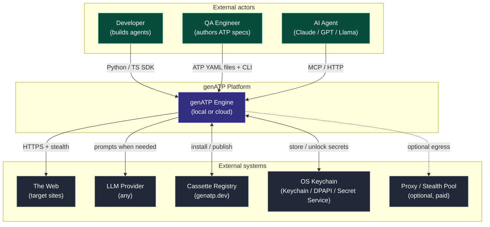

---

## 2. Container View (C4 Level 2)

The genATP engine, broken into deployable processes.

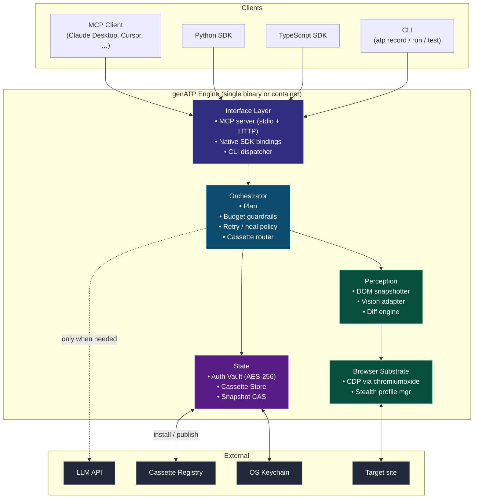

---

## 3. Component View — the Engine internals (C4 Level 3)

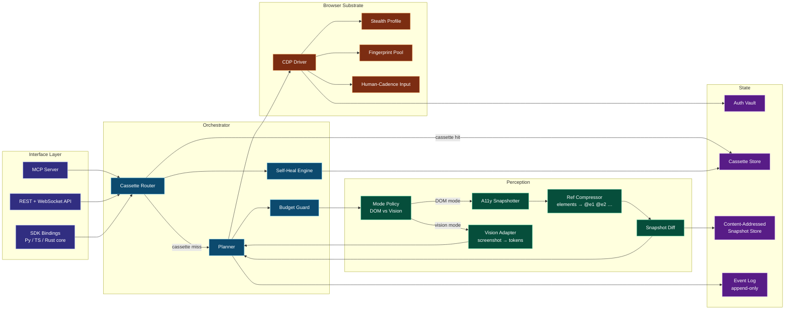

---

## 4. Data Flow — a single agent step

Sequence for one `click` action, showing the cost-optimal path.

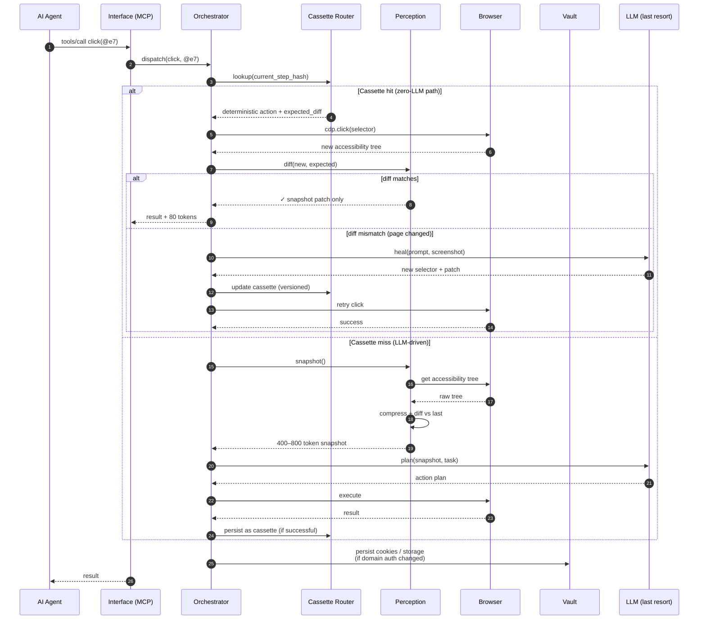

**Token math (design targets)**: a cassette-hit costs **0 LLM tokens** (deterministic replay; optional heal uses a scoped LLM call only on drift). A cassette-miss plan step costs ~600 tokens (compressed snapshot + reply). A vision-fallback step costs ~12,000 tokens. The cassette router tries replay before planning whenever a matching cassette exists.

---

## 5. Perception Mode Policy

The decision tree that picks between DOM and Vision, automatically.

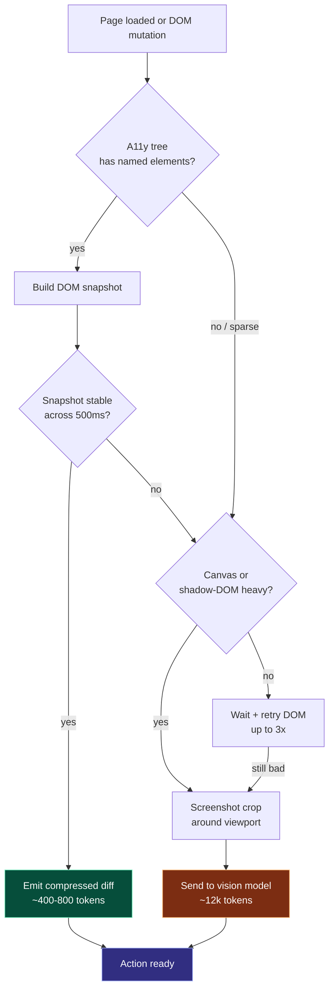

---

## 6. Cassette Lifecycle

How a "skill" goes from recorded → replayed → healed → shared.

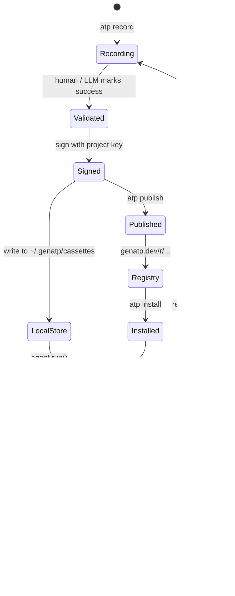

A cassette is a signed JSON document:

```jsonc
{
  "id": "cas_2j9z…",
  "version": "1.3.0",
  "domain": "github.com",
  "task_hash": "sha256:…",
  "steps": [
    { "act": "navigate", "url": "https://github.com/login" },
    { "act": "fill", "ref": "@e1", "from": "vault:github/user" },
    { "act": "click", "ref": "@e4", "expect_diff_hash": "…" }
  ],
  "auth_required": ["github.com"],
  "signature": "ed25519:…",
  "published_by": "@maya",
  "verified_by": ["genatp-team"]
}
```

---

## 7. Auth Vault

```mermaid
graph LR
    subgraph user["User boundary"]
        BIO[Biometric / passkey]
        OS[OS Keychain<br/>Keychain · DPAPI · Secret Service]
    end

    subgraph vault["Auth Vault"]
        KEK[Key-Encryption Key<br/>unlocked by OS]
        DEK[Per-domain<br/>Data Keys]
        STORE[(Encrypted store<br/>~/.genatp/vault.db)]
    end

    subgraph runtime["Runtime"]
        ENG[genATP Engine]
        BC[Browser Context<br/>per domain]
    end

    BIO --> OS
    OS -->|"unwrap"| KEK
    KEK -->|"AES-256-GCM"| DEK
    DEK -->|"decrypt on use"| STORE
    STORE --> ENG
    ENG -->|"hydrate cookies +<br/>localStorage + IDB"| BC

    classDef sec fill:#581c87,stroke:#d8b4fe,color:#fff
    classDef sys fill:#1f2937,stroke:#6b7280,color:#fff
    classDef rt fill:#064e3b,stroke:#6ee7b7,color:#fff
    class KEK,DEK,STORE sec
    class BIO,OS sys
    class ENG,BC rt
```

**Properties**
- Vault never leaves disk un-encrypted; KEK lives only in OS keychain.
- Per-domain DEKs mean a single compromised domain key doesn't leak others.
- Vault entries are *capabilities*: a cassette declares which domains it needs, the engine prompts the user once, and the grant is scoped.

---

## 8. Deployment Topologies

### 8.1 Local-only (default)

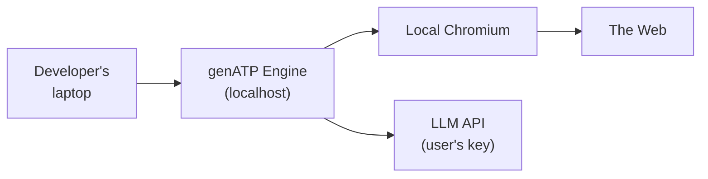

Zero infrastructure. Zero accounts. Auth vault on disk, encrypted by OS keychain.

### 8.2 Self-hosted server (team)

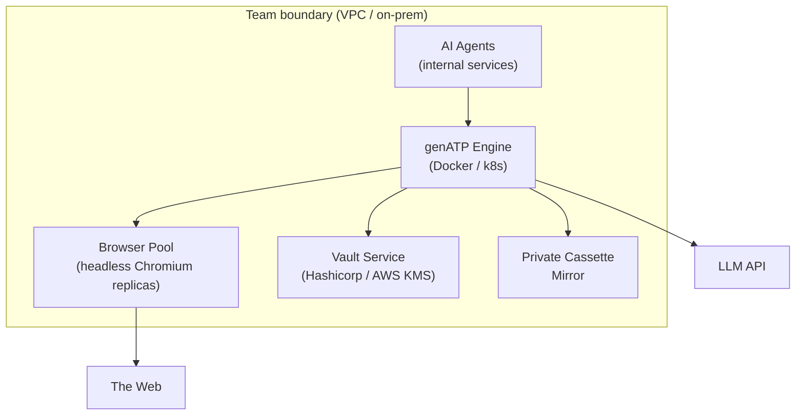

### 8.3 Hosted / managed (out of scope for this repo)

Managed cloud pools, residential proxies, and HSM vaults are **not** implemented in the self-hosted open product. The diagram below is a possible future commercial topology only — do not treat it as shipped architecture.

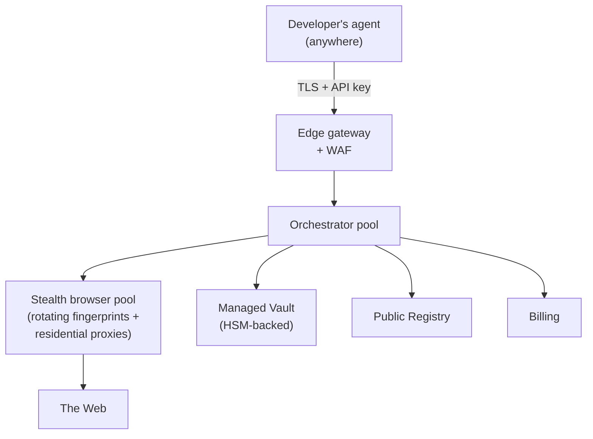

---

## 9. Token Optimization Pipeline

Every snapshot passes through this pipeline before reaching the LLM.

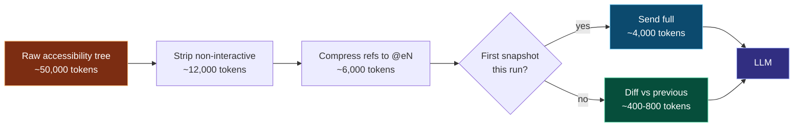

Numbers from internal benchmarks against the Playwright MCP baseline on WebVoyager subset. End-to-end this delivers a 60×–120× token reduction vs the naive raw-HTML path and a ~10× reduction vs Playwright MCP.

---

## 10. Snapshot Content-Addressed Storage

Every snapshot, action, and diff is hashed and chained. This gives us:

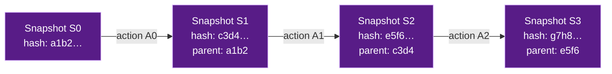

Capabilities unlocked:
- **Time-travel debugging** — `atp replay --at S2` reproduces exact state.
- **Deterministic cassettes** — replay verifies hash chain on every step.
- **Audit trails** — every production run is fully reconstructable.
- **De-duplication** — identical snapshots stored once across all runs.

---

## 11. Technology Choices

| Layer | Choice | Why |
|---|---|---|
| Core engine | Rust (Tokio) | Cold-start in milliseconds, no GC pauses in hot path, memory safety |
| Browser driver | **Direct CDP via `chromiumoxide`** (soft-fork when needed) | Sub-ms action dispatch; avoids Playwright Node IPC (~15–40 ms/step) and detectable CDP fingerprint |
| Browser binary | System Chrome + runtime CDP overrides (v0.1–v0.4); patched Chromium build (v0.5+) | Proven stealth path before custom Chromium pipeline |
| MCP server | `rmcp` (official Rust MCP SDK) | Spec-compliant, stdio + HTTP |
| HTTP API | `axum` | Standard async Rust stack |
| Python SDK | PyO3 + maturin | Native speed, single source of truth |
| TS SDK | NAPI-RS | Same engine, no behavioural drift |
| Local storage | SQLite (`rusqlite`) | Vault, cassettes, snapshot index — zero infra |
| Cloud storage | Postgres + S3 | Multi-tenant, content-addressed blobs |
| Content addressing | BLAKE3 | Faster than SHA-256; native Rust |
| Vault crypto | `ring` + OS keychain (Keychain / DPAPI / Secret Service) | Audited, native |
| Cassette format | JSON (JCS) + zstd, signed with ed25519 | Inspectable, compact, verifiable |
| Registry | OCI Distribution Spec v1.1 on S3 + CDN | Industry standard |
| LLM | In-house `genatp-llm` trait (no LangChain in core) | Provider-agnostic; adapters optional |
| Telemetry | Opt-in, OpenTelemetry, never page content | Privacy-first |

Full rationale and rejected alternatives: [`DEVELOPMENT_PLAN.md` §2](./DEVELOPMENT_PLAN.md#2-tech-stack-decision-record).

---

## 12. Security Model

- **Cassettes are capabilities, not blank checks.** A cassette declares the domains and vault entries it needs. The engine prompts the user once before execution; grants are scoped, revocable, and logged.
- **Signed publishing.** Public Registry entries require ed25519 signatures; the CLI shows the signer for every install.
- **Sandboxed replay.** Cassettes execute in a hardened browser context: no extension installs, no file-system access from page JS, no `localhost` navigation unless explicitly allowed.
- **Vault isolation.** Per-domain DEKs; browser contexts are spawned with only the secrets the cassette declared.
- **No data ever leaves localhost in self-hosted Personal mode.** Telemetry is fully opt-in and content-redacted by default.

---

## 13. Performance Budgets

| Operation | Budget |
|---|---|
| Cold start (CLI → first snapshot) | < 2 s |
| Page snapshot (DOM mode) | < 250 ms |
| Cassette replay step | < 50 ms (no LLM) |
| Vision fallback step | < 1.5 s |
| Vault unlock (per session) | < 100 ms |
| 20-step WebVoyager task (avg) | < 35,000 tokens total |
