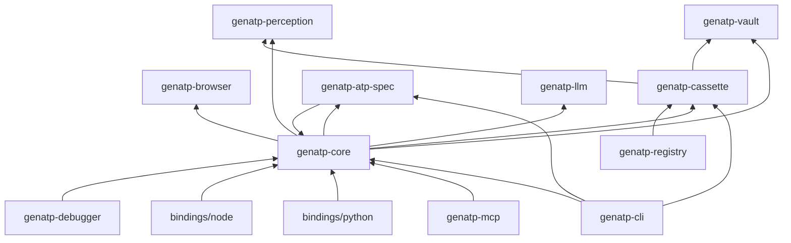
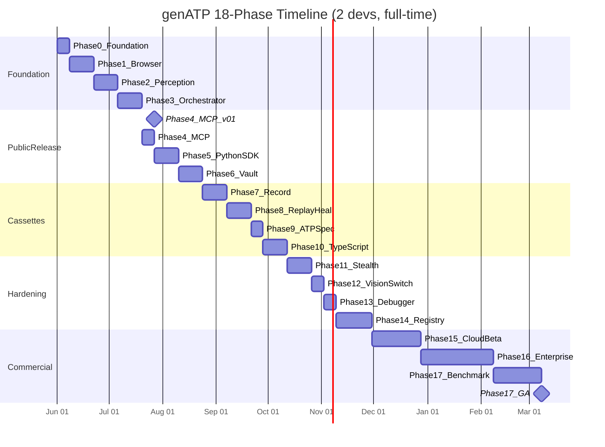

# genATP — Development Plan

**Version:** 1.0  
**Last updated:** 2026-05-22  
**Audience:** Founding engineering team (2 developers)  
**Companion docs:** [PRD](./PRD.md) · [Architecture](./ARCHITECTURE.md) · [User Flows](./USER_FLOWS.md)

---

## Table of contents

1. [Executive summary](#1-executive-summary)
2. [Tech stack decision record](#2-tech-stack-decision-record)
3. [Repository and workspace layout](#3-repository-and-workspace-layout)
4. [Testing taxonomy](#4-testing-taxonomy)
5. [Phase overview](#5-phase-overview)
6. [Phases 0–17 (detailed)](#6-phases-017-detailed)
7. [Cross-cutting engineering practices](#7-cross-cutting-engineering-practices)
8. [Release cadence and branch model](#8-release-cadence-and-branch-model)
9. [Risk register](#9-risk-register)
10. [Out of scope (v2+)](#10-out-of-scope-v2)
11. [Glossary](#11-glossary)
12. [Appendix](#12-appendix)

---

## 1. Executive summary

genATP is a **production-grade, extremely fast** unified web-access layer for AI agents. This plan sequences **18 phases** over approximately **40 calendar weeks** for a **2-person full-time team**, with **testing embedded in every phase** — no phase is complete until its CI gates pass on all five release targets.

### What we are building

| Layer | Deliverable |
|---|---|
| Core | Rust engine (Tokio), single static binary, sub-2s cold start |
| Browser | Direct Chrome DevTools Protocol (CDP) — **not Playwright** |
| Interfaces | MCP server, Python SDK (PyO3), TypeScript SDK (NAPI-RS), CLI |
| Differentiators | Action Cassettes, ATP Spec, Cassette Registry |
| Commercial | genATP Cloud (Phase 15), Enterprise (Phase 16) |

### Guiding principles

1. **Reliable** — deterministic cassette replay, hash-chain verification, property tests on crypto and parsers.
2. **Extremely fast** — Rust hot path, CDP-native actions, diff snapshots (~400–800 tokens/step).
3. **Best** — choose the stack that wins benchmarks and production audits, not the fastest path to a demo.

### Key milestones

| Week | Release | What ships |
|---|---|---|
| 8 | **v0.1.0** | MCP server + perception + orchestrator (first public release) |
| 10 | v0.2.0 | Python SDK |
| 12 | v0.3.0 | Auth Vault |
| 16 | v0.5.0 | Cassettes (record + replay + self-heal) + ATP Spec |
| 19 | v0.6.0 | TypeScript SDK |
| 21 | v0.7.0 | Stealth engine |
| 26 | v0.8.0 | Cassette Registry |
| 30 | Cloud beta | Managed infrastructure |
| 36 | Enterprise | SOC 2 Type I, SSO, on-prem |
| 40 | **v1.0.0** | GA + published WebVoyager benchmark |

---

## 2. Tech stack decision record

### 2.1 Final choices

| Layer | Choice | Rationale |
|---|---|---|
| **Language** | Rust (stable, MSRV pinned) + Tokio | Millisecond cold start, no GC pauses in hot path, memory safety for vault/crypto |
| **Browser driver** | Direct CDP via `chromiumoxide` (soft-fork when needed) | Sub-ms action dispatch; avoids Playwright's Node IPC (~15–40 ms/step) and detectable CDP fingerprint |
| **Browser binary** | System Chrome + runtime CDP overrides (v0.1–v0.4); reproducibly-built patched Chromium (v0.5+) | Proven anti-detection path (`nodriver`/`zendriver` model) before custom Chromium build pipeline |
| **MCP server** | `rmcp` (official Rust MCP SDK) | Spec-compliant, stdio + HTTP |
| **HTTP API** | `axum` + Tower middleware | Standard async Rust stack |
| **Python SDK** | PyO3 + maturin | Native speed, one engine, no drift |
| **TypeScript SDK** | NAPI-RS | Same engine in Node/Bun/Deno |
| **Local storage** | SQLite (`rusqlite`) | Vault, cassettes, snapshot index — zero infra, ACID |
| **Cloud storage** | Postgres + S3 | Multi-tenant, content-addressed blobs |
| **Crypto** | `ring` (AES-256-GCM, ed25519) + `keyring` crate | Audited primitives; OS keychain integration |
| **Content addressing** | BLAKE3 | Faster than SHA-256; native Rust |
| **Cassette format** | JSON (JCS canonical) + zstd + ed25519 | Human-inspectable, compact, verifiable |
| **Registry** | OCI Distribution Spec v1.1 on S3 | Industry standard |
| **LLM** | In-house `genatp-llm` trait (Anthropic, OpenAI, Google, Mistral, Ollama, vLLM) | No LangChain in core; adapters optional |
| **Observability** | `tracing` + OpenTelemetry (opt-in in Personal/self-hosted tier) | Cost attribution per span |
| **CLI** | `clap` | Subcommands: `serve`, `record`, `run`, `test`, `replay`, `install` |

### 2.2 Rejected alternatives

| Alternative | Why rejected |
|---|---|
| **Playwright as browser driver** | Node.js IPC per action; Cloudflare/DataDome fingerprint Playwright CDP signature; cannot ship custom stealth at CDP level |
| **Python-only core** | GC latency unacceptable for 50 ms cassette replay steps; GIL limits browser pool concurrency |
| **TypeScript-only core** | Same IPC/GC issues; harder to ship single static binary for CLI/MCP |
| **Electron / Puppeteer** | Heavier footprint; weaker stealth story than direct CDP |
| **Protobuf cassettes (v1)** | Poor debuggability; JSON+zstd meets size targets with inspectability |
| **LangChain in core** | Version churn, heavy deps, behaviour drift across agent frameworks |
| **Custom proxy network (v1)** | Capital-intensive; partner with Bright Data / similar for Cloud tier |

### 2.3 Resolved open questions (from PRD)

| Question | Decision |
|---|---|
| Rust-native browser vs Playwright? | **CDP-native from day one** (Phase 1) |
| Cassette format? | **JSON (JCS) + zstd + ed25519** |
| Default LLM in CLI? | **None** — user supplies API key via `genatp init` → OS keychain |
| Registry topology? | **Central npm-style** for v1; federated mirrors post-v2 |

---

## 3. Repository and workspace layout

### 3.1 Monorepo structure

```
genATP/
├── Cargo.toml                    # workspace root
├── deny.toml                     # cargo-deny policy
├── rust-toolchain.toml           # MSRV pin
├── crates/
│   ├── genatp-core/              # orchestrator, plan loop, budget guard
│   ├── genatp-browser/           # CDP client, browser pool, stealth hooks
│   ├── genatp-perception/        # snapshot, diff, ref compression, vision
│   ├── genatp-vault/             # encrypted auth store
│   ├── genatp-cassette/          # record, replay, self-heal
│   ├── genatp-atp-spec/          # YAML parser, IR, runner
│   ├── genatp-mcp/               # MCP server (rmcp)
│   ├── genatp-llm/               # provider trait + adapters
│   ├── genatp-cli/               # clap CLI binary
│   ├── genatp-registry/          # OCI registry client/server
│   └── genatp-debugger/          # event log + replay UI backend
├── bindings/
│   ├── python/                   # PyO3 + maturin
│   └── node/                     # NAPI-RS
├── fixtures/
│   ├── sites/                    # pinned HTML/SPA test pages
│   ├── cassettes/                # golden cassette files
│   ├── snapshots/                # insta golden files
│   └── llm/                      # VCR-recorded provider responses
├── benches/                      # criterion benchmarks
├── fuzz/                         # cargo-fuzz targets
├── tests/
│   ├── integration/
│   └── e2e/
├── cloud/                        # k8s, Terraform (Phase 15+)
├── docs/                         # PRD, ARCHITECTURE, this file, ADRs
├── examples/
│   ├── mcp-claude-desktop/
│   ├── python-quickstart/
│   ├── atp-spec-ci/
│   └── registry-publish/
└── .github/workflows/
    ├── ci.yml
    ├── bench-regression.yml
    ├── nightly-stealth.yml
    └── release.yml
```

### 3.2 Crate dependency graph



### 3.3 CI target matrix (all phases)

| Target | OS | Arch |
|---|---|---|
| `x86_64-unknown-linux-gnu` | Ubuntu 22.04 | x86_64 |
| `aarch64-unknown-linux-gnu` | Ubuntu 22.04 | arm64 |
| `x86_64-apple-darwin` | macOS 14 | x86_64 |
| `aarch64-apple-darwin` | macOS 14 | arm64 |
| `x86_64-pc-windows-msvc` | Windows 2022 | x86_64 |

---

## 4. Testing taxonomy

Every phase lists which layers apply. **A phase is not complete until all listed gates are green.**

| Layer | Tooling | When introduced | Merge gate |
|---|---|---|---|
| **Unit** | `cargo test`, `cargo nextest`, pytest, vitest | Phase 0 | Required |
| **Snapshot** | `insta` (Rust), golden files | Phase 2 | Required for parsers/perception |
| **Property-based** | `proptest`, `hypothesis`, `fast-check` | Phase 2 | Required for diff, vault, budget |
| **Fuzz** | `cargo-fuzz` | Phase 7 | Required for all deserialisers |
| **Integration** | Custom fixture server + testcontainers | Phase 1 | Required |
| **E2E** | Real Chromium + fixture sites + WebVoyager subset | Phase 3 | Required from Phase 4 |
| **Benchmark** | `criterion` | Phase 1 | >5% hot-path regression blocks merge |
| **Anti-detection** | bot.sannysoft, fingerprintjs/botd, creepjs | Phase 1 baseline; Phase 11 full | Nightly from Phase 11 |
| **Security** | `cargo-audit`, `cargo-deny`, `semgrep`, dependency-review | Phase 0 | Every PR |
| **SBOM** | `cargo-cyclonedx` | Phase 0 | Every release |
| **Mutation** | `cargo-mutants` | Phase 8 | vault, cassette, atp-spec crates |
| **Reproducibility** | 5-machine cassette replay | Phase 8 | Phase exit |
| **Penetration** | Third-party firm | Phase 15 | Cloud GA blocker |
| **Load** | k6 / Locust against Cloud API | Phase 15 | 10k concurrent sessions |

---

## 5. Phase overview



| Phase | Name | Cal. weeks | Release tag | Owner |
|---|---|---|---|---|
| 0 | Foundation | 0–1 | — | Dev A |
| 1 | Browser substrate | 1–3 | — | Dev A |
| 2 | Perception engine | 3–5 | — | Dev B |
| 3 | LLM + Orchestrator | 5–7 | — | Both |
| 4 | MCP server v0.1 | 7–8 | **v0.1.0** | Dev B |
| 5 | Python SDK | 8–10 | v0.2.0 | Dev A |
| 6 | Auth Vault | 10–12 | v0.3.0 | Dev B |
| 7 | Cassette recording | 12–14 | — | Dev A |
| 8 | Cassette replay + heal | 14–16 | **v0.5.0** | Both |
| 9 | ATP Spec | 16–17 | v0.5.1 | Dev B |
| 10 | TypeScript SDK | 17–19 | v0.6.0 | Dev A |
| 11 | Stealth engine | 19–21 | v0.7.0 | Dev B |
| 12 | DOM/Vision switch | 21–22 | v0.7.1 | Dev A |
| 13 | Time-travel debugger | 22–23 | v0.8.0-pre | Dev B |
| 14 | Cassette Registry | 23–26 | v0.8.0 | Both |
| 15 | Cloud private beta | 26–30 | cloud-beta | Both + contractor |
| 16 | Enterprise prep | 30–36 | enterprise-preview | Dev B + consultant |
| 17 | v1.0 GA + benchmark | 36–40 | **v1.0.0** | Both |

---

## 6. Phases 0–17 (detailed)

---

### Phase 0 — Foundation

| Field | Detail |
|---|---|
| **Calendar** | Week 0–1 |
| **Goal** | Empty repo compiles, tests, and releases on all 5 targets |

#### Scope

- Initialise Cargo workspace with all crate stubs (`lib.rs` + one passing test each).
- `rust-toolchain.toml` with MSRV (e.g. 1.78).
- `deny.toml` (licenses, bans, advisories).
- GitHub Actions: build + test matrix (5 targets), `cargo clippy -D warnings`, `cargo fmt --check`.
- Pre-commit hooks: `rustfmt`, `clippy`, `taplo fmt`, `cargo deny check`.
- `cargo-dist` for release tarballs; `maturin` / `napi` build stubs in `bindings/`.
- `codecov` integration; branch protection rules.
- ADR template in `docs/adr/0000-template.md`.
- Fixture server skeleton (`fixtures/sites/hello.html`).

#### Crates / files touched

- Root `Cargo.toml`, all `crates/*/Cargo.toml`, `.github/workflows/ci.yml`, `deny.toml`, `CONTRIBUTING.md`, `SECURITY.md`.

#### Testing matrix

| Layer | Scope |
|---|---|
| Unit | `assert!(true)` per crate — proves linkage |
| Security | `cargo deny check`, `cargo audit` in CI |
| SBOM | `cargo cyclonedx` on tag (manual first run) |

#### Acceptance criteria

- [ ] `cargo test --workspace` green on 5 targets
- [ ] `cargo clippy --workspace -- -D warnings` green
- [ ] Pre-commit installs in < 2 min on fresh clone
- [ ] Release workflow produces unsigned tarball artifact (smoke)

#### Exit criteria

**Empty repo produces a release tarball for all 5 targets.**

---

### Phase 1 — Browser substrate

| Field | Detail |
|---|---|
| **Calendar** | Week 1–3 |
| **Goal** | CDP-native Chromium control: launch, navigate, a11y tree, cookies |

#### Scope

- `genatp-browser`:
  - `chromiumoxide` integration (fork if upstream blocks stealth hooks).
  - `BrowserPool`: acquire/release contexts, max concurrency config.
  - Launch args: disable automation flags, realistic viewport, locale, timezone.
  - CDP commands: `Page.navigate`, `DOM.getDocument`, `Accessibility.getFullAXTree`, `Network.setCookie`, `Storage.getDOMStorageItems`.
  - Cookie + localStorage hydration API (for vault integration in Phase 6).
  - Graceful shutdown, zombie process reaper.
- Demo binary: `genatp_browser_demo`.

#### Crates / files touched

- `crates/genatp-browser/src/{pool,cdp,launch,storage}.rs`
- `benches/browser_cold_start.rs`
- `tests/integration/browser_navigate.rs`

#### Testing matrix

| Layer | Scope | Gate |
|---|---|---|
| Unit | URL parsing, launch-arg builder, cookie serialisation | 100% on pure functions |
| Integration | Launch Chrome, navigate `fixtures/sites/hello.html`, fetch a11y tree | CI with `CHROME_PATH` |
| Benchmark | Cold start → first navigation | **< 800 ms** p95 |
| Anti-detection | bot.sannysoft.com baseline | Document score; no hard gate yet |

#### Acceptance criteria

- [ ] Navigate fixture site and return a11y tree with ≥ 1 interactive element
- [ ] Pool supports 4 concurrent contexts without leak (valgrind/heaptrack optional)
- [ ] Demo completes in < 1 s on developer laptop

#### Exit criteria

**`cargo run --bin genatp_browser_demo` launches Chromium, navigates, fetches a11y tree, closes — under 1 s.**

---

### Phase 2 — Perception engine

| Field | Detail |
|---|---|
| **Calendar** | Week 3–5 |
| **Goal** | Token-optimized snapshots with diff compression |

#### Scope

- `genatp-perception`:
  - A11y snapshotter (wrap browser output → internal `Snapshot` type).
  - ARIA noise stripper (remove decorative nodes, empty groups).
  - Ref compressor: assign `@e1`, `@e2`, … stable within a page session.
  - BLAKE3 content-addressed store (SQLite table: `hash → blob`).
  - Diff engine: compute minimal patch between snapshots.
  - Token estimator (chars/4 heuristic + model-specific overrides).
  - Vision adapter **scaffold** only (trait + stub; implementation Phase 12).
- Export: `compress(snapshot) -> CompressedSnapshot`, `diff(prev, curr) -> Patch`.

#### Crates / files touched

- `crates/genatp-perception/`
- `fixtures/snapshots/*.json` (insta)
- `fixtures/sites/` — expand to 50 pages (static + SPA samples)
- `benches/perception_tokens.rs`

#### Testing matrix

| Layer | Scope | Gate |
|---|---|---|
| Unit | Ref assignment stability, diff invertibility | Required |
| Snapshot | `insta` on 50 fixture pages | Review on intentional change |
| Property | `proptest`: `apply(diff(a,b), a) == b` | 10k cases |
| Benchmark | Snapshot latency | **< 250 ms** p95 per page |
| Benchmark | Token count after compression | **< 800 tokens** avg on fixture suite |
| CI gate | Token regression | Fail if avg > **850 tokens** |

#### Acceptance criteria

- [ ] ≥ 90% token reduction vs raw a11y tree on fixture corpus
- [ ] Diff patch for "click opens dropdown" scenario < 100 tokens
- [ ] Snapshot store deduplicates identical hashes

#### Exit criteria

**≥ 90% token reduction vs raw a11y tree across the 50-page fixture corpus.**

---

### Phase 3 — LLM client + Orchestrator

| Field | Detail |
|---|---|
| **Calendar** | Week 5–7 |
| **Goal** | End-to-end agent loop with budget guard |

#### Scope

- `genatp-llm`:
  - `LlmProvider` trait: `complete`, `complete_with_tools`, streaming, token counting.
  - Adapters: Anthropic, OpenAI, Google, Mistral, Ollama, vLLM.
  - VCR fixture recording for CI (no live API keys in CI by default).
- `genatp-core`:
  - Plan loop: snapshot → LLM → action → repeat.
  - Action dispatcher: maps LLM tool calls to browser commands.
  - Budget guard: token, time, USD limits; soft warn at 80%, hard stop at 100%.
  - Retry policy: exponential backoff on transient errors.
  - Event log (append-only, for debugger in Phase 13).

#### Crates / files touched

- `crates/genatp-llm/`, `crates/genatp-core/`
- `fixtures/llm/*.json`
- `tests/e2e/form_fill.rs`

#### Testing matrix

| Layer | Scope | Gate |
|---|---|---|
| Unit | Budget guard never negative; retry bounds | Property tests |
| Integration | Provider adapters against VCR fixtures | No network in CI default |
| Integration | Form fill on `fixtures/sites/form.html` via Ollama (optional job) | Nightly |
| E2E | 5-step task on fixture site | Required |
| Property | Budget: `sum(charges) <= limit` always | proptest |

#### Acceptance criteria

- [ ] 5-step form-fill task completes on fixture site
- [ ] Budget aborts run before exceeding declared limit
- [ ] Event log contains ordered entries for every step

#### Exit criteria

**5-step task completes end-to-end against fixture site.**

---

### Phase 4 — MCP server v0.1 (FIRST PUBLIC RELEASE)

| Field | Detail |
|---|---|
| **Calendar** | Week 7–8 |
| **Release** | **v0.1.0** |
| **Goal** | Any MCP client can browse the web via genATP |

#### Scope

- `genatp-mcp`:
  - Transports: stdio (primary), HTTP (secondary).
  - Tools: `navigate`, `snapshot`, `click`, `fill`, `extract`, `scroll`, `screenshot`, `get_url`, `go_back`.
  - Tool schemas validated against MCP spec.
  - Resource: current snapshot (optional).
- `genatp-cli`: `genatp serve --stdio`, `genatp serve --port 3000`.
- Documentation: MCP setup guide for Claude Desktop and Cursor.
- Blog post draft for launch.

#### Crates / files touched

- `crates/genatp-mcp/`, `crates/genatp-cli/`
- `examples/mcp-claude-desktop/mcp_config.json`
- `docs/MCP.md`

#### Testing matrix

| Layer | Scope | Gate |
|---|---|---|
| Unit | Tool schema JSON matches MCP spec examples | Required |
| Integration | stdio round-trip: call each tool | Required |
| E2E | Claude Desktop: "find 5 PRs on github.com" (manual checklist + recorded demo) | Pre-release sign-off |
| E2E | WebVoyager **subset** (50 tasks) | ≥ 70% success (baseline) |
| Security | No secrets in logs; API keys only from env/keychain | Review |

#### Acceptance criteria

- [ ] All tools callable via MCP Inspector
- [ ] README quickstart works with Claude Desktop
- [ ] Published GitHub release with binaries for 5 targets
- [ ] Published benchmark subset results (honest, reproducible)

#### Exit criteria

**v0.1.0 on GitHub. Claude Desktop completes "find me 5 PRs on github.com" using only genATP tools.**

---

### Phase 5 — Python SDK

| Field | Detail |
|---|---|
| **Calendar** | Week 8–10 |
| **Release** | v0.2.0 |
| **Goal** | `pip install genatp` — PRD quickstart works |

#### Scope

- `bindings/python/`:
  - PyO3 module `genatp._native`.
  - `Agent` class: `run(task: str) -> Result`.
  - Async API (`asyncio` compatible).
  - Type stubs (`.pyi`) via `pyo3-stub-gen` or manual.
  - Optional: `genatp.langchain` adapter (tools export).
  - Optional: `genatp.llamaindex` adapter.
- `maturin` publish to PyPI (testpypi first).
- mkdocs site: API reference auto-generated.

#### Crates / files touched

- `bindings/python/`, `pyproject.toml`, `docs/python/`

#### Testing matrix

| Layer | Scope | Gate |
|---|---|---|
| Unit | pytest for pure Python wrapper logic | Required |
| Integration | `Agent.run` against fixture site | Required |
| Matrix | Python 3.10, 3.11, 3.12 × 5 platforms | All green |
| Smoke | `pip install genatp && python examples/quickstart.py` | Release gate |

#### Acceptance criteria

- [ ] PRD 5-line quickstart passes on all 5 CI targets (Linux x86_64/aarch64, macOS x86_64/aarch64, Windows x86_64)
- [ ] Wheels on PyPI for all platforms (or clear documented exceptions in release notes)
- [ ] LangChain adapter exports 8+ tools and integration test against fixture site passes
- [ ] Async API verified with `pytest-asyncio` round-trip

#### Exit criteria

**`pip install genatp` works on all 5 platforms; PRD quickstart passes.**

---

### Phase 6 — Auth Vault

| Field | Detail |
|---|---|
| **Calendar** | Week 10–12 |
| **Release** | v0.3.0 |
| **Goal** | Login once, stay logged in across restarts |

#### Scope

- `genatp-vault`:
  - Schema: `domains`, `entries` (cookies, localStorage, IndexedDB metadata).
  - Per-domain DEK derived from master KEK.
  - KEK wrapped by OS keychain (`keyring` crate).
  - Capability tokens: cassette declares `auth: [domains]`, user grants once.
  - CLI: `genatp vault list`, `genatp vault revoke <domain>`.
  - MCP tools: `save_auth`, `load_auth`, `list_auth`.
  - Migrations: `vault_schema_version` in SQLite.

#### Crates / files touched

- `crates/genatp-vault/`
- `docs/VAULT.md`
- MCP + core integration

#### Testing matrix

| Layer | Scope | Gate |
|---|---|---|
| Unit | AES roundtrip, DEK isolation | Required |
| Property | Decrypt wrong domain DEK fails | proptest |
| Integration | Real OS keychain on macOS, Windows, Linux CI | Per-OS jobs |
| Security | Vault file bytes un-decryptable without keychain | Required |
| Benchmark | Unlock latency | **< 100 ms** p95 |
| Mutation | `cargo-mutants` on vault crate | ≥ 80% score |

#### Acceptance criteria

- [ ] Login to fixture auth site → kill process → restart → still authed
- [ ] Revoke capability → next run prompts again
- [ ] Vault file never contains plaintext cookies

#### Exit criteria

**Log into github.com → kill process → restart → agent still authenticated, zero prompts.**

---

### Phase 7 — Cassette recording

| Field | Detail |
|---|---|
| **Calendar** | Week 12–14 |
| **Goal** | Record successful runs as signed, versioned cassettes |

#### Scope

- `genatp-cassette` (record path):
  - Cassette schema v1 (JSON JCS + zstd + ed25519).
  - Recorder hooks on orchestrator event log.
  - Storage: `~/.genatp/cassettes/<slug>/versions/`.
  - CLI: `atp record`, `atp list`, `atp inspect`.
  - Signing: project key in `~/.genatp/keys/`.

#### Crates / files touched

- `crates/genatp-cassette/`
- `fuzz/cassette_deserialize/`
- `fixtures/cassettes/golden/`

#### Testing matrix

| Layer | Scope | Gate |
|---|---|---|
| Unit | Serialize roundtrip | Required |
| Fuzz | Malformed cassette bytes | 24h job, no crashes |
| Property | Every successful orchestrator run → valid cassette | Required |
| Snapshot | Golden cassette files | Review on change |
| Security | Invalid signature rejected | Required |

#### Acceptance criteria

- [ ] Record github login + repo lookup → file < 10 KB
- [ ] Cassette human-readable after zstd decompress
- [ ] Signature verifies with project public key

#### Exit criteria

**Record github login + repo lookup → cassette file < 10 KB, human-inspectable.**

---

### Phase 8 — Cassette replay + self-heal

| Field | Detail |
|---|---|
| **Calendar** | Week 14–16 |
| **Release** | **v0.5.0** |
| **Goal** | Deterministic replay with 0 LLM tokens; auto-heal on drift |

#### Scope

- Replay engine:
  - Hash-chain verification per step (`parent_hash` linkage).
  - Deterministic action dispatch (no LLM when DOM matches).
  - Drift detector: compare expected diff hash vs actual.
  - Self-heal: on drift, call LLM with screenshot + intent → patch cassette → bump semver.
- CLI: `atp run <slug>`, `atp run <slug> --heal`.
- Cassette router in orchestrator (check before plan loop).

#### Testing matrix

| Layer | Scope | Gate |
|---|---|---|
| E2E | 20 cassettes replay on fixture sites | 100% pass |
| E2E | Intentional DOM mutations (rename, wrap, reorder) | **≥ 80%** heal success |
| Benchmark | Replay step latency | **< 50 ms** p95 |
| Token | Replay without drift | **0 LLM tokens** |
| Reproducibility | Same cassette on 5 CI machines | Bit-identical results |
| Mutation | `cargo-mutants` on cassette crate | ≥ 80% |

#### Acceptance criteria

- [ ] Replay 100× without drift → 0 LLM calls
- [ ] Drift on step 4 → heal → v1.1 written automatically
- [ ] Hash chain invalid if cassette tampered

#### Exit criteria

**Replay cassette 100× deterministically. Intentional UI change triggers heal and version bump without human intervention.**

---

### Phase 9 — ATP Spec parser + runner

| Field | Detail |
|---|---|
| **Calendar** | Week 16–17 |
| **Release** | v0.5.1 |
| **Goal** | Declarative YAML tests and automations |

#### Scope

- `genatp-atp-spec`:
  - JSON Schema for `.atp.yml`.
  - Parser → intermediate representation (IR).
  - Runner: execute IR via orchestrator + cassette router.
  - Assertions: `assert`, `assert_not`, `assert_url`.
  - Output: JUnit XML, JSON report.
  - CLI: `atp test`, `atp run`, `atp validate`.
- Example repo: `examples/atp-spec-ci/` with GitHub Actions workflow.

#### Testing matrix

| Layer | Scope | Gate |
|---|---|---|
| Unit | Parser on valid/invalid YAML | Required |
| Fuzz | Malformed YAML bytes | No panics |
| Snapshot | YAML → IR mapping | insta |
| E2E | 10 representative specs | All green in example CI |

#### Acceptance criteria

- [ ] `atp test` returns exit code 1 on assertion failure
- [ ] JUnit XML consumed by GitHub Actions annotations
- [ ] `on_change: heal` triggers cassette bump in CI

#### Exit criteria

**Working CI example repo where `atp test` blocks merges on assertion failures.**

---

### Phase 10 — TypeScript SDK

| Field | Detail |
|---|---|
| **Calendar** | Week 17–19 |
| **Release** | v0.6.0 |
| **Goal** | `npm install genatp` at parity with Python |

#### Scope

- `bindings/node/`:
  - NAPI-RS native module.
  - `Agent` class, async/await API.
  - Full `.d.ts` types.
  - Optional `@genatp/langchain` adapter.
- Publish to npm (provenance attestation).

#### Testing matrix

| Layer | Scope | Gate |
|---|---|---|
| Unit | vitest | Required |
| Matrix | Node 18, 20, 22 + Bun smoke + Deno smoke | Required |
| Integration | TS quickstart | Required |
| Build | 4 platforms × 2 archs | All green |
| Parity | TS and Python SDK behave identically on shared contract tests | Required |

#### Acceptance criteria

- [ ] `npm install genatp` works on all supported platforms
- [ ] PRD TS quickstart passes
- [ ] Type definitions (`.d.ts`) cover 100% of public API; no `any` leaks
- [ ] Parity contract tests pass against Python SDK on identical fixture inputs
- [ ] npm package published with provenance attestation

#### Exit criteria

**`npm install genatp` works everywhere; PRD TS quickstart passes.**

---

### Phase 11 — Stealth engine

| Field | Detail |
|---|---|
| **Calendar** | Week 19–21 |
| **Release** | v0.7.0 |
| **Goal** | Pass common bot detection; clear Cloudflare/DataDome on test sites |

#### Scope

- Runtime CDP overrides (v0.7):
  - `navigator.webdriver` removal, plugin enumeration, WebGL vendor/renderer.
  - Viewport, screen, timezone, locale consistency.
  - Bezier mouse paths, click offset jitter.
  - Typing inter-key delay distribution (gamma, not uniform).
  - Network timing jitter on fetch/XHR.
- Fingerprint pool: rotate profiles per session.
- Patched Chromium binary (stretch goal within phase; else v0.8):
  - Reproducible build pipeline documented.
- Nightly adversarial suite in CI.

#### Testing matrix

| Layer | Scope | Gate |
|---|---|---|
| Anti-detection | bot.sannysoft.com | **100%** pass |
| Anti-detection | fingerprintjs/botd | **≥ 90%** |
| Anti-detection | creepjs | Realistic-score band (document thresholds) |
| Nightly | Full adversarial suite | No regression vs baseline |
| E2E | Cloudflare challenge on whitelisted test property | Consistent pass |
| E2E | DataDome challenge on whitelisted test property | Consistent pass |

#### Acceptance criteria

- [ ] Fingerprint pool ships with ≥ 25 realistic profiles
- [ ] Mouse-curve and typing-delay distributions documented and randomised per session
- [ ] No detectable `navigator.webdriver` or other automation flags
- [ ] Nightly adversarial suite runs unattended and posts results to internal dashboard
- [ ] WebVoyager subset success rate improves ≥ 10 points vs pre-phase baseline

#### Exit criteria

**Clears default Cloudflare and DataDome challenges on whitelisted test sites consistently.**

---

### Phase 12 — DOM/Vision auto-switch

| Field | Detail |
|---|---|
| **Calendar** | Week 21–22 |
| **Release** | v0.7.1 |
| **Goal** | Transparent fallback to vision on canvas/shadow-DOM pages |

#### Scope

- Vision adapter implementation (Claude, GPT-4o, Gemini).
- Perception policy engine (decision tree from ARCHITECTURE.md).
- Coordinate-based actions when refs unavailable.
- Agent-facing API unchanged (same snapshot shape).

#### Testing matrix

| Layer | Scope | Gate |
|---|---|---|
| Unit | Policy decision tree | 100% branch coverage |
| E2E | Canvas fixture page → vision route | Required |
| E2E | Normal form page → DOM route only | 0 vision calls |
| Benchmark | Vision step end-to-end | **< 1.5 s** p95 |
| Benchmark | Vision token cost | < 14k tokens per step p95 |

#### Acceptance criteria

- [ ] Policy correctly routes 100% of fixture pages (50 DOM, 10 canvas, 5 shadow-DOM)
- [ ] Agent API shape unchanged between DOM and vision modes (no behavioural drift)
- [ ] Vision adapter supports Anthropic Claude, OpenAI GPT-4o, Google Gemini
- [ ] Coordinate-based actions verified on at least one canvas fixture page

#### Exit criteria

**Snapshot a canvas dashboard and extract structured data successfully.**

---

### Phase 13 — Time-travel debugger

| Field | Detail |
|---|---|
| **Calendar** | Week 22–23 |
| **Release** | v0.8.0-pre |
| **Goal** | Scrub through any failed run frame-by-frame |

#### Scope

- `genatp-debugger`:
  - Read event log + snapshot CAS.
  - REST API: list runs, get step, get snapshot blob.
  - Web UI: React + Vite, timeline scrubber, diff viewer.
- CLI: `atp replay <run_id>`, `atp replay <run_id> --at 4`.
- Slack webhook: post replay link on CI failure (example workflow).

#### Testing matrix

| Layer | Scope | Gate |
|---|---|---|
| Property | Event log hash chain integrity | proptest |
| E2E | Record → kill → restore at step N | Required |
| UI | Playwright tests on debugger UI | Required |
| Performance | Snapshot blob retrieval | < 100 ms p95 |

#### Acceptance criteria

- [ ] Any past run reproducible step-by-step from event log + CAS
- [ ] Web UI loads timeline for a 100-step run in < 1 s
- [ ] Diff viewer highlights snapshot changes between adjacent steps
- [ ] CLI `atp replay <run_id> --at N` returns a usable snapshot for any N
- [ ] Slack webhook example runbook documented

#### Exit criteria

**Failed CI run posts Slack link → opens UI → scrubs through 20 steps frame-by-frame.**

---

### Phase 14 — Cassette Registry

| Field | Detail |
|---|---|
| **Calendar** | Week 23–26 |
| **Release** | v0.8.0 |
| **Goal** | Publish and install community cassettes with verified signatures |

#### Scope

- `genatp-registry`:
  - OCI Distribution v1.1 API server.
  - Manifest: capabilities, domains, semver, signature.
  - CLI: `atp search`, `atp install`, `atp publish`.
  - Hosted: `genatp.dev/r` (staging first).
  - Self-host: Docker image + Helm chart stub.
  - Trust ladder: unsigned blocked, self-signed warns, verified auto-runs.

#### Testing matrix

| Layer | Scope | Gate |
|---|---|---|
| Conformance | OCI distribution spec tests | Required |
| Security | Malicious cassette cannot access undeclared vault domain | Required |
| Security | Capability prompt fires for every undeclared resource | Required |
| Fuzz | Manifest parser | No panics |
| E2E | Publish on machine A → install on machine B → run | Required |
| E2E | Verified-publisher cassette auto-runs; self-signed warns; unsigned blocked | Required |

#### Acceptance criteria

- [ ] Trust ladder enforced: unsigned blocked, self-signed warns, org-signed auto-runs within org, verified auto-runs
- [ ] `atp install` shows signer, capabilities, and version diff before install
- [ ] Semver resolution behaves like npm (`^`, `~`, exact, prerelease tags)
- [ ] Self-host Docker image + Helm chart stub builds and runs locally
- [ ] New publishers cannot earn "verified" tag for 24h after first publish (publisher cooldown)

#### Exit criteria

**Publish a cassette publicly → another machine `atp install`s and runs it with verified signature.**

---

### Phase 15 — genATP Cloud private beta

| Field | Detail |
|---|---|
| **Calendar** | Week 26–30 |
| **Release** | cloud-beta |
| **Goal** | 50 users on managed infrastructure for 4 weeks |

#### Scope

- Kubernetes orchestrator service (Rust, same engine).
- Browser pool autoscaler (CDP workers).
- Proxy integration (residential IP partner API).
- HSM-backed vault (AWS CloudHSM or GCP KMS).
- Stripe metered billing.
- Dashboard: Next.js + tRPC (usage, sessions, API keys).
- Terraform modules for staging/prod.

#### Testing matrix

| Layer | Scope | Gate |
|---|---|---|
| Integration | API parity with local MCP | Contract tests |
| Load | 10,000 concurrent sessions | p99 < 2s snapshot latency |
| Chaos | Pod kill, network partition | Self-heal < 30s |
| Security | Third-party penetration test | No critical findings open |
| Isolation | Tenant A cannot read tenant B vault | Required |
| Billing | Stripe metered events reconcile to engine telemetry | < 0.1% drift |

#### Acceptance criteria

- [ ] API endpoints feature-flagged for graceful rollouts
- [ ] HSM-backed vault attestation document published to customers
- [ ] Dashboard supports usage metrics, API key rotation, and team membership
- [ ] Residential-proxy partner integrated with per-session rotation
- [ ] Disaster-recovery runbook tested (RPO < 1 h, RTO < 4 h)
- [ ] Public status page operational at `status.genatp.dev`

#### Exit criteria

**50 private-beta users running real workloads continuously for 4 weeks.**

---

### Phase 16 — Enterprise prep

| Field | Detail |
|---|---|
| **Calendar** | Week 30–36 |
| **Release** | enterprise-preview |
| **Goal** | First enterprise contract; SOC 2 Type I |

#### Scope

- SOC 2 Type I controls + evidence (Vanta or manual).
- SAML 2.0 + OIDC (Okta, Azure AD, Google Workspace tested).
- Audit log exporter (Splunk, Datadog, generic S3).
- Customer cassette signing policies (only org keys allowed).
- On-prem Helm chart + air-gap install guide.
- 24/7 paging + status page.

#### Testing matrix

| Layer | Scope | Gate |
|---|---|---|
| Audit | SOC 2 dry-run with consultant | Pass |
| SSO | Okta + Azure AD + Google conformance | Required |
| Deploy | Air-gapped install on fresh VM | Required |
| Docs | SECURITY.md, DATA_PROCESSING.md, DPA | Legal review |
| SIEM | Audit log export verified against Splunk, Datadog, generic S3 sink | Required |

#### Acceptance criteria

- [ ] All SOC 2 Type I controls have documented evidence
- [ ] SSO login + SCIM provisioning tested end-to-end with all three IdPs
- [ ] On-prem Helm chart installs cleanly in air-gapped environment
- [ ] Customer cassette signing policy enforced (only org keys accepted)
- [ ] 24/7 paging rotation live; runbooks published in `docs/runbooks/`
- [ ] Status page + public incident history operational

#### Exit criteria

**Pass dry-run audit; first enterprise contract signed.**

---

### Phase 17 — v1.0 GA + WebVoyager benchmark

| Field | Detail |
|---|---|
| **Calendar** | Week 36–40 |
| **Release** | **v1.0.0** |
| **Goal** | Public benchmark credibility + launch |

#### Scope

- Full WebVoyager suite (586 tasks).
- Public dashboard: `genatp.dev/bench`.
- Methodology repo: reproducible by third parties.
- Comparison table: browser-use, Stagehand, Playwright MCP, genATP.
- Launch: Hacker News, Product Hunt, technical blog, demo video.
- Migration guides from v0.x.

#### Testing matrix

| Layer | Scope | Gate |
|---|---|---|
| Benchmark | WebVoyager success | **≥ 85%** |
| Benchmark | Avg tokens per 20-step task | **≤ 35,000** |
| Reproducibility | Independent re-run from methodology repo | Within 2% of published numbers |
| Release | All Phase 0–16 gates still green | Required |
| Security | Final third-party security review for v1.0 | No high-severity open |

#### Acceptance criteria

- [ ] Public benchmark dashboard live at `genatp.dev/bench`
- [ ] Methodology repo runnable by third party from a single `make benchmark` command
- [ ] Comparison numbers verified against published browser-use, Stagehand, Playwright MCP results
- [ ] Migration guides published for all v0.x → v1.0 breaking changes
- [ ] Launch assets shipped: blog post, demo video, HN draft, Product Hunt page

#### Exit criteria

**WebVoyager ≥ 85% success at ≤ 35k tokens average. v1.0.0 tagged.**

---

## 7. Cross-cutting engineering practices

### 7.1 Documentation

- Every merged PR updates `docs/` or adds an ADR in `docs/adr/`.
- Public API changes require CHANGELOG entry (release-please).
- Breaking changes require migration guide in release notes.

### 7.2 Observability

- All external I/O wrapped in `tracing` spans: `browser.navigate`, `llm.complete`, `vault.unlock`.
- Span fields: `token_count`, `cost_usd`, `duration_ms`, `run_id`.
- Personal/self-hosted: telemetry off by default; `GENATP_TELEMETRY=1` enables OTel export.
- Document schema in `docs/TELEMETRY.md` (created Phase 4).

### 7.3 Security

| Control | Frequency |
|---|---|
| `cargo audit` | Every PR |
| `cargo deny` | Every PR |
| `semgrep` | Every PR |
| GitHub dependency-review | Every PR |
| `cargo vet` | Weekly (vault, crypto deps) |
| `cargo-mutants` | Phase 8+ on critical crates |
| SBOM (`cargo cyclonedx`) | Every release |
| Third-party pen test | Before Cloud GA |
| Quarterly security review | Starting Phase 11 |

### 7.4 Performance

- `criterion` benchmarks in `benches/` run on every PR touching hot paths.
- Regression > **5%** on p95 latency or token count → merge blocked.
- Weekly benchmark report posted to internal dashboard.

### 7.5 Code review

- All changes require 1 approval (2-person team: async review + pair on critical paths).
- Security-sensitive crates (`vault`, `cassette`, `registry`): both developers review.

### 7.6 ADR process

Template: `docs/adr/0000-template.md`

| ADR | Topic | By phase |
|---|---|---|
| ADR-001 | Rust + CDP over Playwright | Phase 0 |
| ADR-002 | Cassette format (JSON+zstd) | Phase 7 |
| ADR-003 | Vault key hierarchy | Phase 6 |
| ADR-004 | OCI registry choice | Phase 14 |
| ADR-005 | Stealth strategy (runtime vs patched binary) | Phase 11 |

---

## 8. Release cadence and branch model

### 8.1 Branches

| Branch | Purpose |
|---|---|
| `main` | Always releasable; protected |
| `dev` | Integration branch; nightly builds |
| `feature/*` | Short-lived feature branches |
| `release/vX.Y` | Stabilisation before tag |

### 8.2 Cadence

| Type | Frequency | Audience |
|---|---|---|
| Nightly | Every weekday from `dev` | Internal |
| Pre-release | Weekly `v0.x.y-pre.N` on `dev` | Early adopters |
| Stable minor | End of each phase | General |
| Patch | On demand; **48h SLO** for critical security | All |

### 8.3 Version mapping

| Tag | Phases included |
|---|---|
| v0.1.0 | 0–4 |
| v0.2.0 | 5 |
| v0.3.0 | 6 |
| v0.5.0 | 7–8 |
| v0.5.1 | 9 |
| v0.6.0 | 10 |
| v0.7.0 | 11 |
| v0.7.1 | 12 |
| v0.8.0 | 13–14 |
| cloud-beta | 15 |
| enterprise-preview | 16 |
| **v1.0.0** | 17 |

### 8.4 Release checklist (every stable tag)

- [ ] CHANGELOG updated (release-please)
- [ ] All CI matrices green
- [ ] Benchmark report attached to release notes
- [ ] SBOM published as release asset
- [ ] PyPI + npm + GitHub binaries published
- [ ] Migration guide if breaking
- [ ] SECURITY.md reviewed

---

## 9. Risk register

| ID | Risk | L | I | Mitigation | Owner |
|---|---|---|---|---|---|
| R1 | Chromium build pipeline delays stealth | M | H | Runtime CDP overrides until patched binary ready | Dev B |
| R2 | Malicious registry cassette | M | H | Mandatory signing, capability sandbox, 24h publisher cooldown | Dev A |
| R3 | Anti-bot arms race | H | M | Nightly adversarial suite; dedicated owner post-Phase 11 | Dev B |
| R4 | LLM provider API drift | M | M | VCR fixtures + trait abstraction; new provider < 1 day | Dev A |
| R5 | `chromiumoxide` upstream breakage | M | H | Soft-fork; pin CDP protocol version | Dev A |
| R6 | 2-person bus factor | H | H | ADRs, docs, no tribal knowledge; contractor for Cloud infra | Both |
| R7 | WebVoyager score below 85% at GA | M | H | Start subset benchmarking Phase 4; iterate weekly from Phase 11 | Both |
| R8 | Competitor ships cassette-like feature | M | M | Registry network effect + signed cassettes moat | Both |
| R9 | SOC 2 audit failure | L | H | Consultant from Phase 15; dry-run Phase 16 | Dev B |
| R10 | Token metrics disputed publicly | M | M | Open methodology repo; reproducible scripts | Dev A |

---

## 10. Out of scope (v2+)

- Mobile app automation (Appium / iOS / Android).
- No-code visual workflow builder.
- Operating residential proxy infrastructure (partner only).
- Custom LLM fine-tuning or hosting.
- Browser extensions as agent tools.
- WebMCP server implementation (client bridge only in v1.x).
- Federated multi-registry topology.

---

## 11. Glossary

| Term | Definition |
|---|---|
| **ATP Spec** | Declarative YAML/JSON format (`.atp.yml`) for agent web tasks |
| **Action Cassette** | Signed, versioned recording of a successful agent run for deterministic replay |
| **CDP** | Chrome DevTools Protocol — direct browser control channel |
| **Cassette Router** | Orchestrator component that chooses replay vs LLM plan |
| **Diff snapshot** | Patch sent to LLM containing only DOM changes since last step |
| **Drift** | When replay expected hash ≠ actual page state |
| **JCS** | JSON Canonicalization Scheme — deterministic JSON serialisation for signing |
| **KEK** | Key-Encryption Key — master key in OS keychain |
| **DEK** | Data-Encryption Key — per-domain key wrapping vault entries |
| **MCP** | Model Context Protocol — agent-to-tool standard |
| **Ref** | Compressed element reference (`@e1`, `@e2`, …) |
| **Self-heal** | LLM-assisted cassette patch on drift |
| **Snapshot CAS** | Content-addressed store of page snapshots (BLAKE3) |
| **WebVoyager** | 586-task benchmark for web agent evaluation |

---

## 12. Appendix

### 12.1 Testing tool inventory

| Tool | Language | Purpose |
|---|---|---|
| `cargo test` / `nextest` | Rust | Unit + integration |
| `proptest` | Rust | Property-based |
| `insta` | Rust | Snapshot testing |
| `cargo-fuzz` | Rust | Fuzzing |
| `criterion` | Rust | Benchmarks |
| `cargo-mutants` | Rust | Mutation testing |
| `cargo-audit` | Rust | Advisory DB |
| `cargo-deny` | Rust | License/ban policy |
| `cargo-vet` | Rust | Dependency audit |
| `cargo-cyclonedx` | Rust | SBOM |
| `pytest` | Python | SDK tests |
| `hypothesis` | Python | Property tests |
| `vitest` | TypeScript | SDK tests |
| `fast-check` | TypeScript | Property tests |
| `semgrep` | Multi | SAST |
| `Playwright` | TS | Debugger UI tests only |
| `k6` | JS | Cloud load tests |
| `testcontainers` | Rust | Integration deps |

### 12.2 CI workflow template (sketch)

```yaml
# .github/workflows/ci.yml (Phase 0 deliverable)
name: CI
on: [push, pull_request]
jobs:
  rust:
    strategy:
      matrix:
        os: [ubuntu-latest, macos-latest, windows-latest]
        target:
          - x86_64-unknown-linux-gnu
          - aarch64-unknown-linux-gnu  # ubuntu only
          - x86_64-apple-darwin
          - aarch64-apple-darwin       # macos only
          - x86_64-pc-windows-msvc
    runs-on: ${{ matrix.os }}
    steps:
      - uses: actions/checkout@v4
      - uses: dtolnay/rust-toolchain@stable
      - run: cargo test --workspace
      - run: cargo clippy --workspace -- -D warnings
      - run: cargo deny check
```

### 12.3 ADR index template

```markdown
# ADR-NNN: Title

## Status
Proposed | Accepted | Deprecated

## Context
What is the issue?

## Decision
What did we decide?

## Consequences
Positive and negative outcomes.
```

### 12.4 Phase completion checklist (copy per phase)

```markdown
## Phase N completion

- [ ] All acceptance criteria met
- [ ] Exit criteria demonstrated (link to CI run / demo)
- [ ] Tests listed in testing matrix are green
- [ ] Benchmark regression gate passed
- [ ] Docs updated
- [ ] ADR written (if architectural decision)
- [ ] CHANGELOG entry added
- [ ] Release tagged (if applicable)
```

### 12.5 Related documents

| Document | Path |
|---|---|
| Product requirements | [PRD.md](./PRD.md) |
| System architecture | [ARCHITECTURE.md](./ARCHITECTURE.md) |
| User journeys | [USER_FLOWS.md](./USER_FLOWS.md) |
| Initial research | [../assets/draft.txt](../assets/draft.txt) |

---

*This plan is the engineering source of truth for genATP v1.0. Update it when phases slip, scope changes, or ADRs supersede decisions above.*
