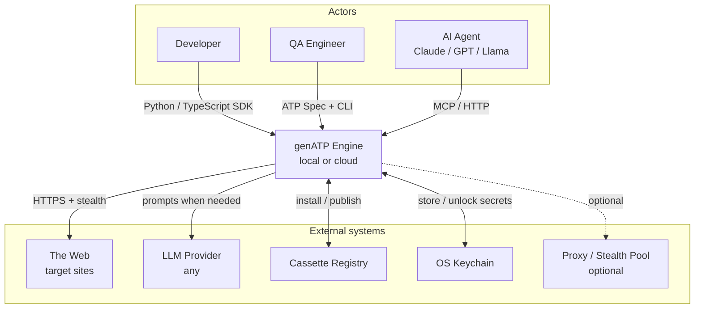
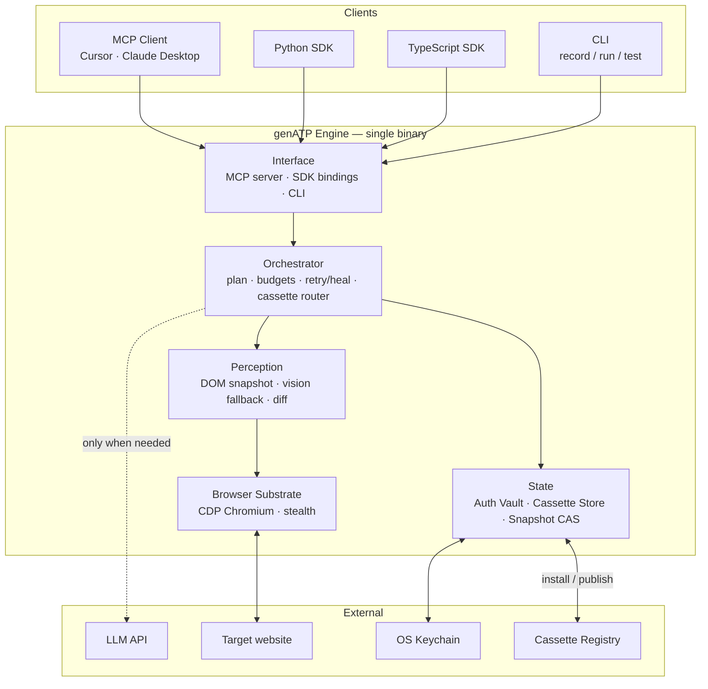
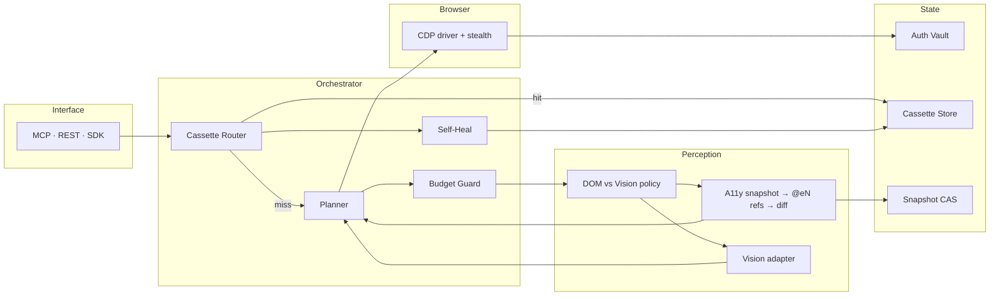

# genATP — Real High-Level System Architecture (PPT)

Three faithful high-level views of **this project’s** architecture
(from [`ARCHITECTURE.md`](./ARCHITECTURE.md)). Not a generic PPT template.

Pick one for the slide.

---

## Variant A — System context (C4 Level 1)

Who talks to genATP, and what genATP talks to.

**What this shows:** genATP is the web-access layer between agents/devs and the real web.

**Pick when:** You want the highest-level “where does this sit in the world?” slide.

---

## Variant B — Engine containers (C4 Level 2) ⭐ recommended

The real internal shape of the product: **one engine, five subsystems**, three client faces.

**What this shows:** All clients hit one Interface; Orchestrator decides plan vs cassette replay; Perception + Browser act on sites; State holds vault/cassettes.

**Pick when:** You want the real product architecture on the slide (best default).

---

## Variant C — Engine internals (C4 Level 3, simplified)

How a request moves inside the engine — including the **cassette hit / miss** split.

**What this shows:** Cassette hit = no LLM. Miss = plan under budget → perceive → act via CDP → persist vault/snapshots; heal updates cassettes.

**Pick when:** Judges should understand *why* genATP is cheaper/faster (router + perception + vault).

---

## Quick pick guide

| Goal | Variant |
|---|---|
| Big-picture placement in the ecosystem | **A — Context** |
| Real high-level system architecture of the product | **B — Engine** ⭐ |
| Deeper path: cassette router + perception + vault | **C — Internals** |

---

## Design tenets (optional one-liner under the diagram)

1. One engine, three faces (MCP, Python SDK, TypeScript SDK)  
2. Tokens are the most expensive resource  
3. State is content-addressed, signable, replayable  
4. Cloud-optional — localhost works fully offline (minus the page itself)

Source of truth: [`docs/ARCHITECTURE.md`](./ARCHITECTURE.md)
