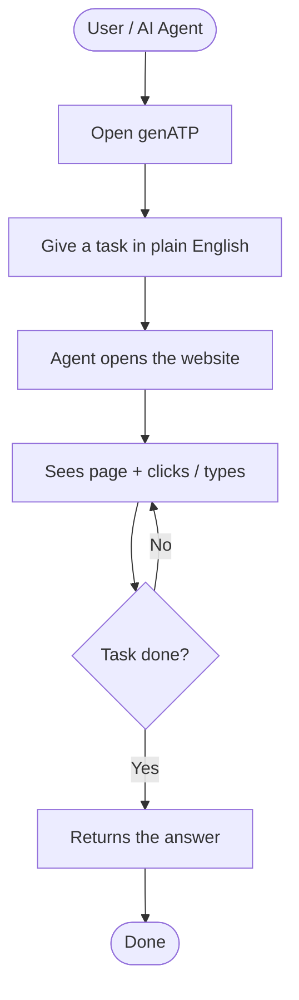
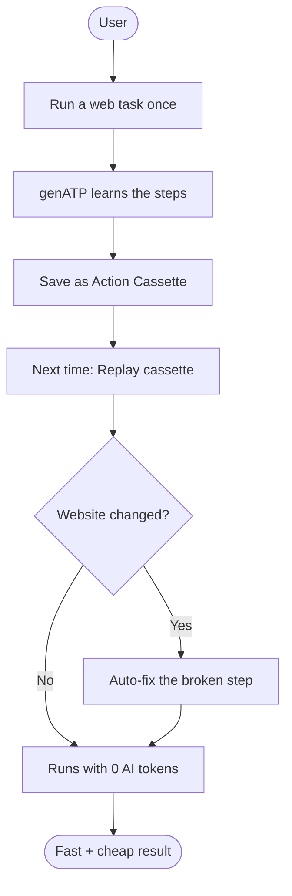

# genATP — High-Level User Flows (PPT)

Simple App Flow variants for hackathon slides. Pick one diagram for the
**App Flow** panel. Keep the chosen variant; delete the others from the
slide.

Audience: non-deep reviewers. No crate names, no CDP internals.

---

## Variant A — “Ask → Browse → Done” (simplest)

Best default for the PPT. One happy path anyone can follow in 5 seconds.

**Slide caption:** *User gives a goal → genATP browses for them → result.*

**One-line story:** Install once → ask in English → agent uses the web → you get the answer.

---

## Variant B — “Learn once → Replay forever” (cassette story)

Best if you want to highlight the unique selling point (0-token replay).

**Slide caption:** *Record once → replay forever → heal only when needed.*

**One-line story:** Pay for AI thinking once; every later run is free and fast.

---

## Variant C — “Two doors into the same engine” ⭐ (chosen / PPT-ready)

Same information as before. Redrawn to match the SAGAR **App Flow** style:
two tall columns, pastel colors, blue ovals / green actions / purple decisions.

### Exact dimensions for PPT
**Aspect ratio = 3 (breadth) : 4 (length)** → `750 × 1000` px

**Use this file for the slide (screenshot / export):**
[`docs/app-flow-variant-c-3x4.html`](./app-flow-variant-c-3x4.html)

Open it in a browser, then:
1. Zoom so the white panel fills the view
2. Screenshot / snip the `750×1000` stage
3. Drop into the PPT App Flow panel (no crop stretch)

**Color key (same as template image)**
- Light blue oval = start / end / landing state
- Light green rounded box = action step
- Light purple diamond = choice / branch

**Slide caption:** *Same engine — chat (MCP) or code (SDK) — then vault + replay.*

**One-line story:** Use from chat or code; log in once; reuse the workflow later.

**Bottom-right slide label:** `App Flow` (like the template)

### Rebuild checklist for PowerPoint / draw.io
Use this if Mermaid export looks cramped — same nodes, SAGAR layout:

| Color | Shape | Nodes |
|---|---|---|
| Blue oval | Start/end | `genATP` · `Open in Cursor / Claude` · `Write a short script` · `Get result` |
| Green box | Action | `Talk to AI in chat` · `AI calls genATP tools` · `Browse the web` · `Use Python / JS SDK` · `agent.run(task)` · `Browse the web` · `Save login once in Auth Vault` · `Next runs stay logged in` · `Continue task` · `Save Cassette / ATP Spec` |
| Purple diamond | Decision | `Need login?` · `Want to reuse?` |

**Layout**
1. Top center: **genATP** (blue)
2. Left column title: **Chat Flow** → Open in Cursor/Claude → Talk → AI tools → Browse
3. Right column title: **Code Flow** → Write script → SDK → agent.run → Browse
4. Both Browse arrows meet at **Need login?** (purple)
5. Then **Want to reuse?** (purple) → **Get result** (blue)

---

## Quick pick guide

| If your slide goal is… | Choose |
|---|---|
| Maximum clarity for judges | **Variant A** |
| Show what makes genATP special | **Variant B** |
| Show product surface (MCP + SDK + vault) | **Variant C** ⭐ |

---

## Suggested PPT labels (match SAGAR-style boxes)

### Variant A boxes
`User / AI Agent` → `Open genATP` → `Give task` → `Browse website` → `Act on page` → `Return answer`

### Variant B boxes
`Run task once` → `Learn steps` → `Save Cassette` → `Replay` → `Site changed?` → `Auto-fix` / `0-token run` → `Result`

### Variant C boxes (SAGAR-style)
`genATP` → **Chat Flow** / **Code Flow** → `Browse the web` → `Need login?` → `Auth Vault` → `Want to reuse?` → `Cassette / ATP Spec` → `Get result`
