# genATP — User Flows

End-to-end journeys for the primary personas, covering install → first success → power use → monetization touchpoints.

> **Personas (full detail in PRD.md)**
> - **Maya** — solo agent builder, Python, hobby/indie
> - **Devansh** — startup CTO, mixed Py/TS, scaling on a budget
> - **Lena** — Fortune 500 ML platform engineer, on-prem, compliance
> - **Tomás** — QA lead, replacing brittle Playwright tests

---

## Flow 1 — Maya's first 90 seconds (the moment we win or lose her)

**Goal:** From discovery (a tweet / GitHub link) to a working agent run in under 90 seconds.

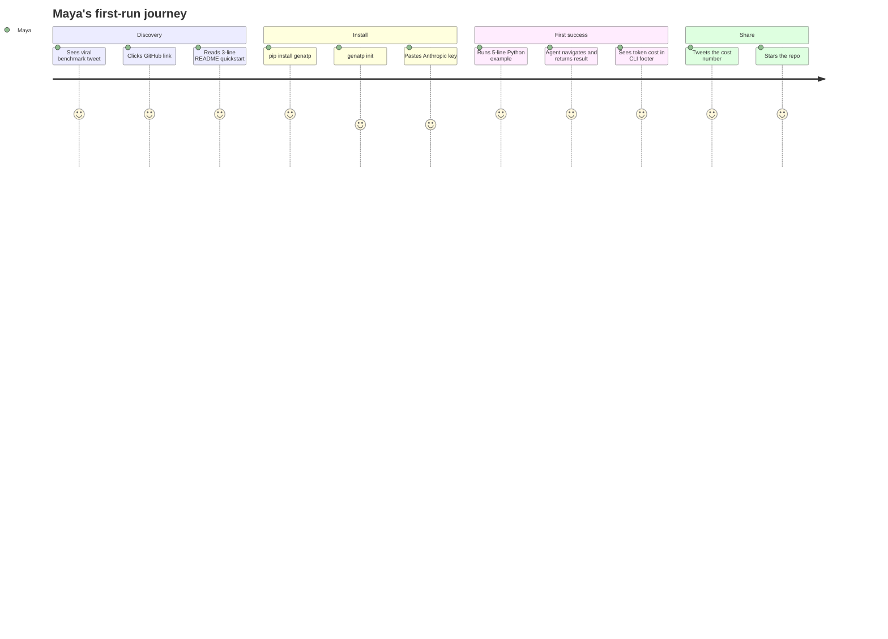

### Detailed flow

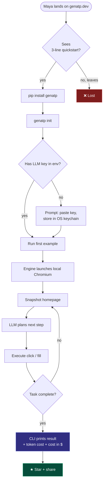

**Critical design rules**
- `pip install genatp` must complete in < 30 s on a clean machine (Chromium fetched on first run if not present).
- The first run must print *something* within 5 s (loading dots are fine — silence is fatal).
- The CLI footer always shows `tokens: 412 · cost: $0.0011 · time: 4.2s`. This is the screenshot people tweet.

---

## Flow 2 — Devansh records a cassette and saves $400/month

**Goal:** Turn a daily, expensive AI agent run into a cheap, deterministic cassette replay with auto-healing.

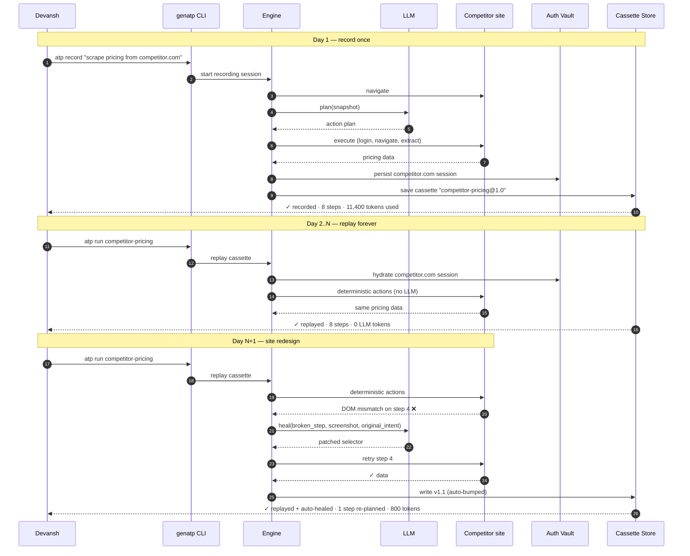

### State view

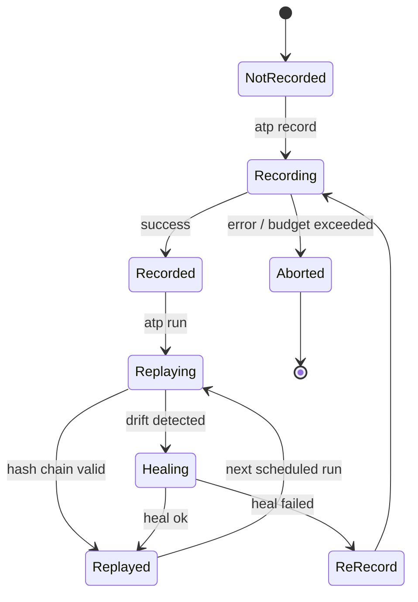

**Cost outcome:**
- Before: 50 competitor sites × 180,000 tokens/run × 30 runs/mo ≈ **$2,700 / month**
- After: 50 × ~400 tokens/run × 30 runs (replay) ≈ **$6 / month**, plus occasional heal costs (~$5)
- **~$2,500 / month saved** with no change to the agent code.

---

## Flow 3 — Tomás replaces brittle Playwright tests with ATP specs

**Goal:** A QA engineer authors a single `.atp.yml` file that works as a test, an automation, and a documentation artifact.

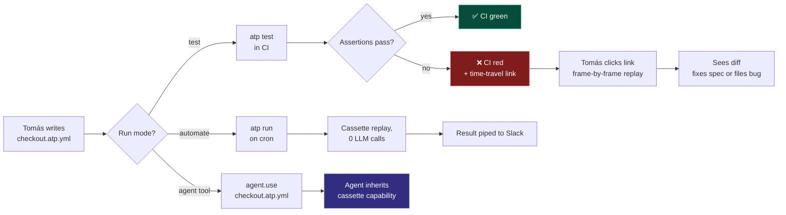

### CI integration sequence

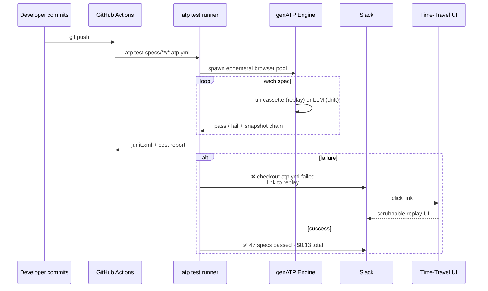

---

## Flow 4 — Lena passes a Fortune-500 security review

**Goal:** A platform engineer evaluates genATP for on-prem deployment and signs an enterprise contract.

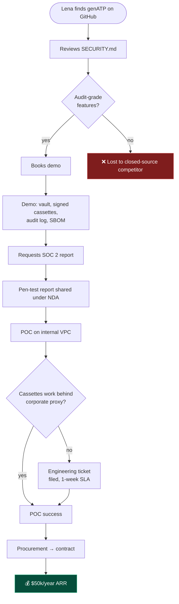

### Enterprise capabilities required at each gate

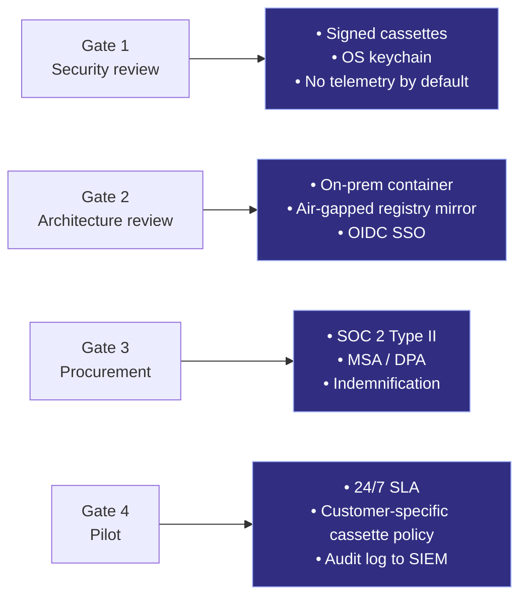

---

## Flow 5 — Authentication & the Vault

**Goal:** An agent logs in once. Across every subsequent run, restart, and machine reboot, the session is restored without prompts or human intervention — yet remains compromise-resistant.

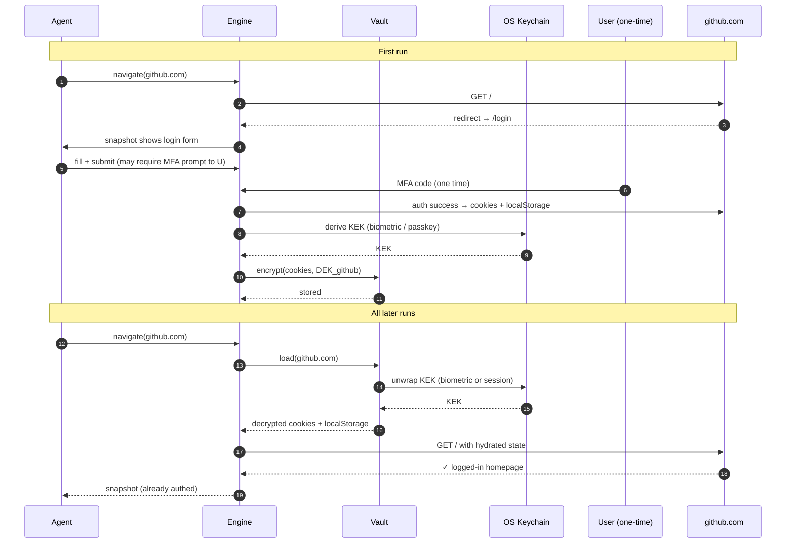

### What the user sees

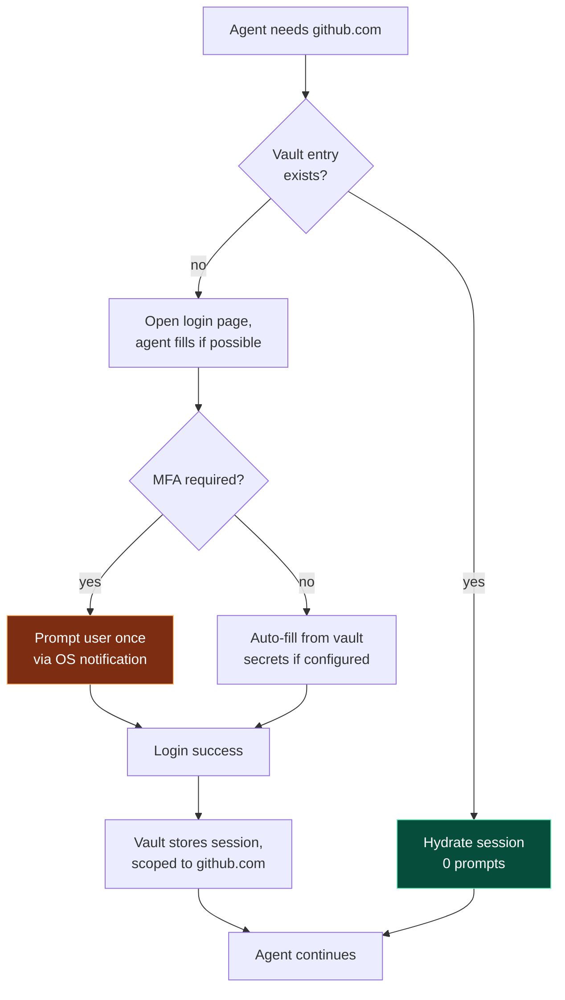

---

## Flow 6 — Discovering and installing a community Cassette

**Goal:** A developer needs to interact with Stripe's billing portal. They install a community-maintained cassette instead of writing one.

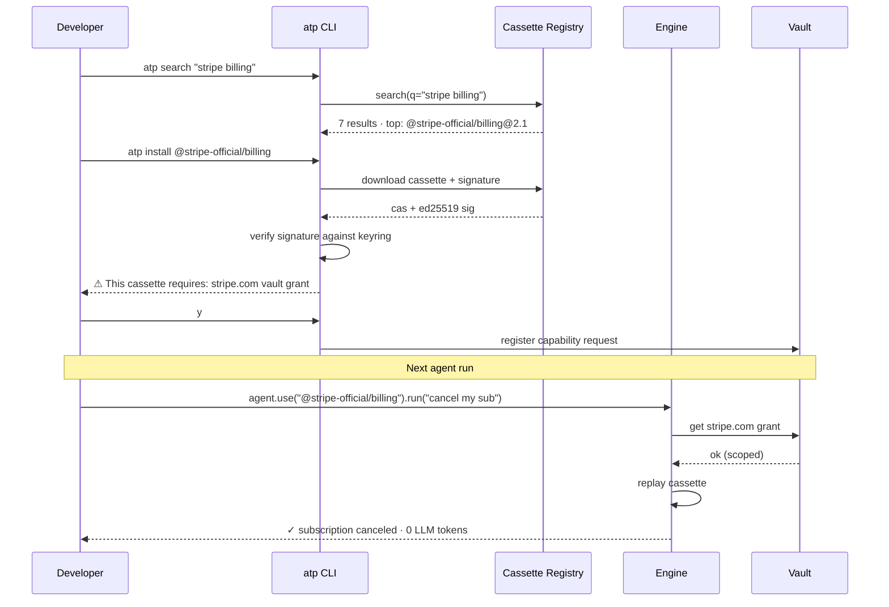

### Trust ladder

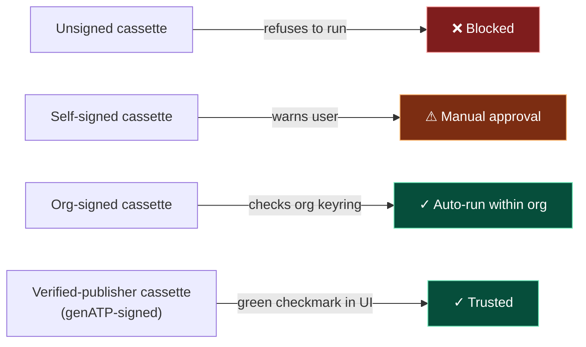

---

## Flow 7 — DOM-mode → Vision fallback (the auto-switch in action)

**Goal:** An agent encounters a canvas-heavy page (e.g., a Figma file or Tableau dashboard) and the engine transparently switches to vision without the agent noticing.

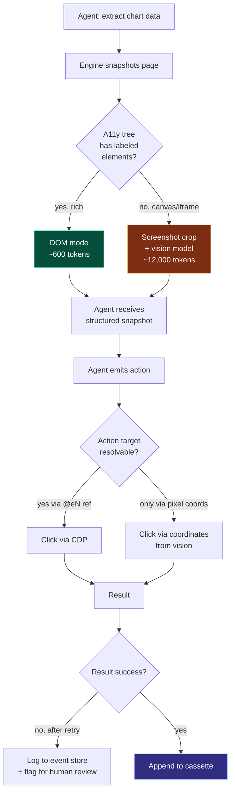

The agent never has to decide; the routing happens inside the engine. From the agent's perspective both modes return the same shape of structured snapshot.

---

## Flow 8 — Budget guardrails (production safety)

**Goal:** A production agent on a runaway loop must abort before burning $100 of tokens.

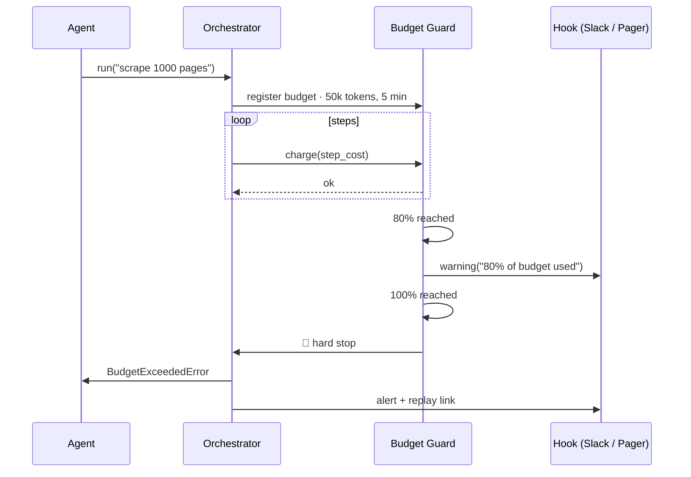

Budgets are declarative (`budget: { tokens: 50000, seconds: 300, usd: 1.00 }`) and apply to ATP specs, SDK calls, and MCP sessions equally. Soft thresholds (80%) notify; hard thresholds (100%) abort.

---

## Flow Index — when to read which

| You want to understand… | Read |
|---|---|
| How a new user gets to "wow" | Flow 1 |
| How cassettes save money | Flow 2 |
| How tests work | Flow 3 |
| How we sell to enterprise | Flow 4 |
| How auth persistence works | Flow 5 |
| How community cassettes work | Flow 6 |
| How DOM↔vision switching works | Flow 7 |
| How we keep production safe | Flow 8 |
